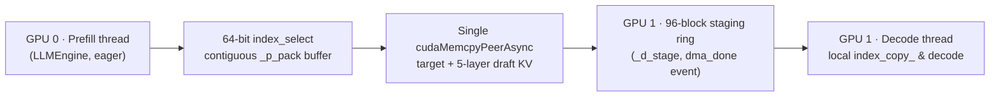

<div align="center">

# nano-vllm-speculative-decoding · Dual-GPU 1P+1D Disaggregation

Single-process, two-thread Prefill-Decode disaggregation for [nano-vLLM](https://github.com/GeeeekExplorer/nano-vllm) with contiguous ring-buffered peer-to-peer (P2P) transfers across plain decoding and DSpark block speculation.

**Whole-run inter-token latency (ITL) p99 (8–64 concurrent): plain 0.15–0.19× · DSpark 0.24–0.31× | Steady-state throughput (32–64 concurrent): plain 1.35–1.52× · DSpark 1.38–1.39×**

[](https://github.com/tianyuantong/nano-vllm-speculative-decoding/actions/workflows/cpu-tests.yml)


[](LICENSE)

[简体中文](README.md) | **English** · [Quick start](#quick-start) · [2-GPU results](docs/RESULTS.md#12-dual-gpu-prefill-decode-disaggregation-1p1d) · [Main branch (DFlash / DSpark) →](https://github.com/tianyuantong/nano-vllm-speculative-decoding/tree/main)

<picture>
  <source media="(prefers-color-scheme: dark)" srcset="docs/assets/pd-1p1d-overview-dark.svg">
  
</picture>

</div>

> **Branch note**: This branch (`disagg/dual-gpu-1p1d`) hosts the dual-GPU 1P+1D Prefill-Decode disaggregation engine ([`DisaggLLM`](nanovllm/disagg/disagg_engine.py) and [`KVCacheTransfer`](nanovllm/disagg/kv_transfer.py)) and its dual-GPU benchmark suite. The four-stage single-GPU speculative decoding engine (DFlash, DSpark, and variable-length verification) lives on [`main`](https://github.com/tianyuantong/nano-vllm-speculative-decoding/tree/main), and the 0.6B standalone draft baseline lives on [`baseline/qwen3-0.6b-draft`](https://github.com/tianyuantong/nano-vllm-speculative-decoding/tree/baseline/qwen3-0.6b-draft).

Measured closed-loop on Qwen3-8B across 2 × RTX PRO 6000 (300 W, PCIe P2P) on the 48-prompt development set against 1-GPU default scheduling and 1-GPU round-robin prefill on the same host (medians over 3 seeds, `prefetch = 0` matching single-GPU in-flight concurrency):

| Line | Concurrent requests | Whole-run ITL p99 (default → 1P+1D) | 1P+1D ratio | 1-GPU RR ratio | Steady-state throughput (default → 1P+1D) | 2-GPU ratio | Per GPU |
|---|---:|---|---|---|---|---|---|
| Plain decoding | 1 | 12.4 → 12.3 ms | 1.00× | — | 82 → 82 tok/s | 1.00× | 0.50× |
| Plain decoding | 8 | 88.3 → 13.3 ms | **0.15×** | 1.00× | 545 → 601 tok/s | 1.10× | 0.55× |
| Plain decoding | 32 | 97.5 → 18.1 ms | **0.19×** | 0.99× | 1,329 → 1,800 tok/s | **1.35×** | 0.68× |
| Plain decoding | 64 | 147.9 → 23.6 ms | **0.16×** | 0.71× | 1,814 → 2,764 tok/s | **1.52×** | 0.76× |
| DSpark (k=7) | 1 | 17.3 → 17.4 ms | 1.01× | — | 165 → 164 tok/s | 0.98× | 0.49× |
| DSpark (k=7) | 8 | 101.1 → 31.6 ms | **0.31×** | 1.00× | 867 → 1,053 tok/s | 1.22× | 0.61× |
| DSpark (k=7) | 32 | 182.9 → 44.8 ms | **0.24×** | 0.72× | 1,488 → 2,060 tok/s | **1.38×** | 0.69× |
| DSpark (k=7) | 64 | 264.5 → 81.4 ms | **0.31×** | 0.61× | 1,660 → 2,307 tok/s | **1.39×** | 0.70× |

`ITL` (inter-token latency) measures the wall-clock gap between consecutive deliveries to a request; `1-GPU RR` denotes single-GPU round-robin prefill. Per-seed ranges and post-arrival breakdowns are in [RESULTS.md §12](docs/RESULTS.md#12-dual-gpu-prefill-decode-disaggregation-1p1d).

## Performance breakdown and trade-offs

- **Why 1P+1D instead of two 1-GPU replicas: eliminating prefill pauses on decode.** At 32–64 concurrent requests, 2-GPU 1P+1D achieves 0.68–0.76× per-GPU throughput (lower aggregate throughput than two independent replicas), because two replicas still pause active decode batches whenever new prompts prefill. Offloading prefill from `cuda:1` cuts the longest single whole-run gap at 64 concurrent requests from 3.37 s to 0.27 s (0.08×) on plain decoding and from 3.52 s to 0.40 s (0.11×) on DSpark (vs 1.00× under 1-GPU round-robin); across post-arrival decode rounds, the longest inter-round gap matches a single decode round (25 ms plain, 81 ms DSpark).
- **Against single-GPU round-robin prefill.** Single-GPU round-robin lowers DSpark's ITL p99 to 0.61–0.72× at 32–64 concurrent requests with zero extra hardware, but still interleaves one prompt's prefill between decode steps; 2-GPU 1P+1D halves DSpark's whole-run ITL p99 again to 0.24–0.31× and drops plain decoding's ITL p99 to 0.15–0.19× (13.3–23.6 ms across 8–64 concurrent requests).
- **Arriving-request time to first token (TTFT).** On plain decoding, post-arrival TTFT p99 drops to 0.90× / 0.67× / 0.38× of 1-GPU default at 8 / 32 / 64 concurrent requests (vs 1.28–1.33× under round-robin). On DSpark it is 1.06× and 1.32× at 8 and 32; at 64 concurrent requests, because `cuda:1` starts decoding the first prefill batch at 0.99 s while `cuda:0` is still prefilling the initial 64-request burst (ending at 4.90 s), 5 short requests finish early and their closed-loop replacements (requests 64..68) queue behind that initial burst for 1.9–3.0 s, raising raw post-arrival TTFT p99 to 1,934 ms (7.06× of default). Once the initial burst clears (requests 70..287), TTFT p99 settles at 297–391 ms (vs 274 ms default and 510 ms round-robin).
- **Prefetch margin (`prefetch = 2`).** Allowing `cuda:0` to prefill 2 extra requests ahead raises DSpark steady-state throughput at 32 and 64 concurrent requests to 1.44× and 1.47×, at the cost of 30–174 ms median handoff wait in the staging ring.

## Core implementation

Inside one Python process, `DisaggLLM` pairs a prefill-only `LLMEngine` on `cuda:0` (eager mode) with a decode/verification `LLMEngine` on `cuda:1` (CUDA Graphs enabled) in ~760 lines of disaggregation code:



- **Push-based contiguous ring-buffer handoff ([`nanovllm/disagg/kv_transfer.py`](nanovllm/disagg/kv_transfer.py))**: `KVCacheTransfer` moves both the 36-layer target KV cache and DSpark's 5-layer draft context KV cache. A `threading.Lock` guards only CPU bookkeeping for ring-slot intervals and in-flight deques—all GPU packing, peer DMA copies, and unpacking run outside the lock; source events stay on `cuda:0` for the prefill thread to reclaim blocks, destination `dma_done` events stay on `cuda:1`, and the decode thread never calls into `cuda:0`.
- **Two-thread pipeline scheduling ([`nanovllm/disagg/disagg_engine.py`](nanovllm/disagg/disagg_engine.py))**: the decode thread admits a staged sequence only after `dma_done.query()` reports ready and `cuda:1` has enough free blocks for its first speculative verification round, unpacking locally on `d_stream` without stalling active requests during PCIe transfers.
- **Per-thread and per-device isolation ([`context.py`](nanovllm/utils/context.py), [`model_runner.py`](nanovllm/engine/model_runner.py))**: replaces global attention metadata with `threading.local()` storage, assigns each `ModelRunner` its own CUDA Graph `capture_stream`, RNG, and single-rank `HashStore` group, and clears the RoPE `@lru_cache` across devices.

## Correctness verification

The dual-GPU smoke gate ([`tools/smoke_pd.py`](tools/smoke_pd.py)) checks three invariants:
- **Serial 1P+1D matches single-GPU `LLM`**: token-identical greedy outputs on both plain decoding and DSpark when stepping serially.
- **Two-thread 1P+1D matches round-admission replay**: across two GPUs, asynchronous handoffs change which decode round each request joins (and thus batch composition), so token-for-token identity against a single engine is not claimed; replaying the recorded admission rounds serially reproduces the two-thread output token for token.
- **Full KV block reclamation**: both `cuda:0` and `cuda:1` `BlockManager` pools return `113 / 113` free blocks on exit, and all 18 default-scheduler runs match the companion single-GPU job token for token.

## Engineering pitfalls

- **Cross-thread device waits and `> 2 GiB` per-block KV copy splitting at 64 concurrent requests**: when the decode thread pulled scattered KV blocks directly from `cuda:0`, 3 of 3 runs at 64 concurrent requests stalled for 3.6 s before the first decode round and hit 891–1,035 ms mid-run freezes on plain decoding, leaving post-arrival DSpark ITL p99 at 0.54–0.65× (102–169 ms). The code path and step timelines point to two interactions: (1) `.tolist()` at the end of `ModelRunner.run` on the prefill thread held the `cuda:0` runtime context lock (`CUcontext`) for ~900 ms while `p_stream` drained (leaving only ~9.5–12.6 ms at the start of each batch before `.tolist()`), blocking the decode thread whenever it pulled from `cuda:0` or destroyed `cuda:0` events; and (2) indexing into a 25.5 GiB (`> 2³¹` bytes) KV pool exceeded 32-bit signed offsets across layers, forcing PyTorch's `TensorIterator` to split **each block's** `copy_` into 16 kernels (~1,088 launches across ~68 blocks in a 14-request handoff, overrunning the launch window). Moving 64-bit `index_select` packing, single-transfer `cudaMemcpyPeerAsync` pushes, and `cuda:0` event cleanup onto the prefill thread—so the decode thread never touches `cuda:0`—reduced initial wave stalls from 3/3 to 0/3, cut plain-decoding inter-round stalls from 891–1,035 ms to 25 ms, and lowered DSpark whole-run ITL p99 to 44.8–81.4 ms (0.24–0.31×).
- **Shared process-wide CUDA Graph capture stream and RoPE cache**: `torch.cuda.graph` uses a single process-wide default capture stream unless an explicit `cuda:1` `capture_stream` is passed (otherwise failing with Triton device-pointer errors on the second GPU), while `get_rope`'s `@lru_cache` reused `cuda:0` rotary tensors on `cuda:1`.
- **Stream-level waits on in-flight KV transfers stall active batches**: making `d_stream` wait directly on `copy_done` forced every running request to wait on PCIe handoffs; polling `dma_done.query()` on the host before admission keeps transfers off the decode stream.

## Quick start

Requires Python 3.10–3.12 and 2 CUDA GPUs with P2P access on the same host (passing the same device ID runs co-located on one GPU for functional checks when `kv_cache_memory_bytes` is set explicitly).

```bash
git clone -b disagg/dual-gpu-1p1d https://github.com/tianyuantong/nano-vllm-speculative-decoding.git
cd nano-vllm-speculative-decoding
pip install torch triton flash-attn "transformers>=4.51" xxhash pytest
python -m pip install -e . --no-deps
```

Run `DisaggLLM` with the dual-GPU configuration exercised in [`tools/smoke_pd.py`](tools/smoke_pd.py):

```python
from nanovllm import SamplingParams
from nanovllm.disagg import DisaggLLM

disagg = DisaggLLM(
    "/models/Qwen3-8B",
    prefill_device=0,
    decode_device=1,
    draft_model="/models/dspark_qwen3_8b_block7",    # omit draft_model and draft_type for plain decoding
    draft_type="dspark",
    max_num_seqs=8,
    max_model_len=1024,
    enable_prefix_cache=False,
    kv_cache_memory_bytes=4 << 30,
    seed=0,
)
params = SamplingParams(temperature=0.0, max_tokens=64)

try:
    outputs = disagg.generate(["Explain KV caching in two sentences."], params, threaded=True)
    print(outputs[0]["text"])
finally:
    disagg.exit()
```

## Reproduce

Run CPU unit tests and the dual-GPU smoke check first, then run back-to-back single-GPU default vs dual-GPU 1P+1D closed-loop benchmarks:

```bash
python -m pytest -q    # CPU tests, including DisaggLLM and ring wrap-around checks
python tools/fetch_panels.py
python tools/smoke_pd.py --models-root /path/to/models --dspark-dir dspark_qwen3_8b_block7 \
    --prefill-device 0 --decode-device 1 --kv-gb 4 --output runs/smoke_2gpu.json

for s in 17011 110017 130031; do
  python tools/bench_pd.py --protocol benchmarks/protocol-v2.3.json --panel D48 \
      --lines k0 dspark_k7 --concurrencies 1 8 32 64 --seed "$s" \
      --prefill-device 0 --decode-device 1 --prefetches 0 2 \
      --models-root /path/to/models --output "runs/bench_pd_s${s}.json"
done
```

Both 72-run dual-GPU directories (before and after the contiguous ring-buffer fix), the 36-run single-GPU round-robin baseline, and the summary script are archived in release [`results-pd-disagg`](https://github.com/tianyuantong/nano-vllm-speculative-decoding/releases/tag/results-pd-disagg).

## Explore the project

| Document / Module | Contents |
|---|---|
| [Dual-GPU 1P+1D results](docs/RESULTS.md#12-dual-gpu-prefill-decode-disaggregation-1p1d) | Throughput, whole-run and post-arrival ITL / TTFT percentiles, and cross-thread stall comparison |
| [`nanovllm/disagg/`](nanovllm/disagg/) | `DisaggLLM` two-thread pipeline and `KVCacheTransfer` contiguous ring-buffer P2P transfer |
| [`tools/smoke_pd.py`](tools/smoke_pd.py) · [`tools/bench_pd.py`](tools/bench_pd.py) | Dual-GPU correctness/reclamation smoke gate and back-to-back closed-loop benchmark driver |
| [Single-GPU round-robin prefill](docs/RESULTS.md#9-round-robin-prefill) | Zero-extra-hardware tail-latency baseline |
| [`main` branch README](https://github.com/tianyuantong/nano-vllm-speculative-decoding/tree/main) | Four-stage single-GPU speculative decoding (0.6B → DFlash → DSpark → variable-length verification) |

## Acknowledgments

Built on [GeeeekExplorer/nano-vllm](https://github.com/GeeeekExplorer/nano-vllm). The single-process two-thread skeleton draws on [nanoPD](https://github.com/HJCheng0602/nanoPD); DSpark weights are from [DeepSpec](https://github.com/deepseek-ai/DeepSpec), with [Qwen3](https://huggingface.co/Qwen/Qwen3-8B) as the base model.
[Upstream history →](docs/UPSTREAM.md)

## License

[MIT](LICENSE).
