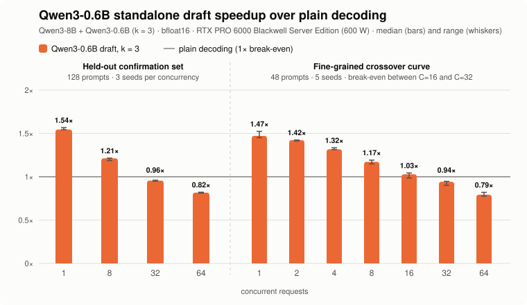
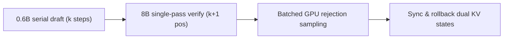

<div align="center">

# nano-vllm-speculative-decoding · 0.6B Standalone Draft Baseline

Batched speculative decoding with a standalone draft model (Qwen3-0.6B) for [nano-vLLM](https://github.com/GeeeekExplorer/nano-vllm).

**Single-request 1.54× · 8 concurrent 1.21× · 32 concurrent 0.96× · 64 concurrent 0.82×**

[](https://github.com/tianyuantong/nano-vllm-speculative-decoding/actions/workflows/cpu-tests.yml)


[](LICENSE)

[简体中文](README.md) | **English** · [Quick start](#quick-start) · [Full results](docs/v2/RESULTS.md) · [Design](docs/design/batched-speculative-decoding.md) · [Main branch (DFlash / DSpark) →](https://github.com/tianyuantong/nano-vllm-speculative-decoding/tree/main)

<picture>
  <source media="(prefers-color-scheme: dark)" srcset="docs/assets/speedup-06b-k128-dark.svg">
  
</picture>

</div>

> **Branch note**: This branch (`baseline/qwen3-0.6b-draft`) freezes and archives the Stage 1 **Qwen3-0.6B standalone draft** implementation, dual-model KV scheduler, and baseline benchmarks. Subsequent **DFlash parallel block drafting, DSpark, and variable-length verification** live on [`main`](https://github.com/tianyuantong/nano-vllm-speculative-decoding/tree/main), and dual-GPU 1P+1D disaggregation lives on [`disagg/dual-gpu-1p1d`](https://github.com/tianyuantong/nano-vllm-speculative-decoding/tree/disagg/dual-gpu-1p1d).

Measured on Qwen3-8B (target) + Qwen3-0.6B (draft, k=3) on a single RTX PRO 6000 (600 W), with standard rejection sampling preserving the target model's output distribution.

| Concurrent requests | 0.6B draft (k=3) | Tokens / round | vs Plain decoding |
|---:|---|---|---|
| 1 | **1.54×** | 2.52 | Faster |
| 8 | **1.21×** | 2.49 | Faster |
| 32 | 0.96× | 2.53 | Overtaken by verification cost |
| 64 | 0.82× | 2.53 | Overtaken by verification cost |

Values are steady-state throughput multiples over plain decoding in the same job on the 128-prompt held-out test set (left panel, medians over 3 seeds). The right panel shows the full decay curve across 1 / 2 / 4 / 8 / 16 / 32 / 64 concurrent requests on the 48-prompt development set (medians over 5 seeds: **1.47× → 1.42× → 1.32× → 1.17× → 1.03× → 0.94× → 0.79×**), placing the break-even point between 16 and 32 concurrent requests. Per-seed ranges and phase timings are in [Full comparison details →](docs/v2/RESULTS.md) · [Initial v1 report →](docs/v1/RESULTS.md)

## Performance breakdown and bottlenecks (why we moved to block drafting)

- **Serial autoregressive drafting takes over a third of each round.** Although reading Qwen3-0.6B's 1.2 GB of weights takes only 0.7 ms at peak bandwidth, launching ~300 kernels across its 28 layers costs 2.1–3.6 ms per step. Running k=3 serial draft steps plus the catch-up step takes 6–13 ms out of a 19–31 ms round, making larger k unprofitable.
- **Verification compute overtakes draft savings at high concurrency.** The target model scores k+1 positions per request in one forward pass; as concurrency rises, verification cost grows linearly, reaching break-even near 16 concurrent requests (1.03×) and falling below 1× from 32 concurrent requests onward (0.94–0.96×).
- **Motivation for Stage 2 block drafting (`main` branch).** Eliminating serial draft steps and dual KV caches with a 5-layer non-causal block draft (DFlash / DSpark) proposes 7 tokens in a single forward pass and raises speedups on the same 128-prompt test set to **2.19× / 1.80× / 1.40× / 1.08×** (1.31–1.48× faster than this 0.6B baseline).

## Core implementation

This branch integrates standalone-model drafting, single-pass target verification, and batched GPU rejection sampling into nano-vLLM's decoding loop:

- **Dual-model execution and independent KV management**: the scheduler manages separate block tables and memory pools for the target and draft models (`kv_cache_memory_bytes` and `draft_kv_cache_memory_bytes`), keeping both KV states synchronized across prefill, token acceptance, rejection rollback, and sequence completion ([`nanovllm/engine/scheduler.py`](nanovllm/engine/scheduler.py)).
- **Fixed-length CUDA Graph verification**: fixed-length drafts (k=3) and padded batch shapes allow both target verification and draft steps to reuse captured CUDA Graphs across rounds ([`nanovllm/engine/speculative.py`](nanovllm/engine/speculative.py)).
- **Vectorized GPU rejection sampling**: proposal probabilities, target ratios, and residual resampling stay entirely on the GPU via `SpecSampler`, copying results to the CPU once per round in 0.03–0.5 ms ([`nanovllm/layers/spec_sampler.py`](nanovllm/layers/spec_sampler.py)).



## Correctness verification

Candidates are verified via standard rejection sampling: accept $x$ when $u \lt \min(1, p_{\text{target}}(x) / p_{\text{draft}}(x))$, otherwise resample from $\text{normalize}(\max(p_{\text{target}} - p_{\text{draft}}, 0))$, guaranteeing the exact target output distribution.

Verified on GPU across four checks:
- Multi-step sampler output distribution (29 test cases, total variation distance ≤ 0.0031)
- Acceptance rate and residual frequency on real model distributions (0.453 observed vs 0.456 analytic acceptance rate, 0.0008 max frequency gap)
- Verification logits against step-by-step decoding (0.75 max absolute difference, identical argmax at all decided positions)
- GSM8K math reasoning accuracy (85.6% vs 85.2% plain decoding, +0.4 pt difference, 95% CI −0.8 to +1.6 pt)

## Quick start

Requires Python 3.10–3.12 and a CUDA GPU with enough memory for Qwen3-8B, Qwen3-0.6B, and both KV caches.

```bash
git clone -b baseline/qwen3-0.6b-draft https://github.com/tianyuantong/nano-vllm-speculative-decoding.git
cd nano-vllm-speculative-decoding
pip install torch triton flash-attn "transformers>=4.51" xxhash pytest
python -m pip install -e . --no-deps
```

Set the local model paths and generate:

```python
from nanovllm import LLM, SamplingParams

llm = LLM(
    "/models/Qwen3-8B",
    draft_model="/models/Qwen3-0.6B",
    num_speculative_tokens=3,
    max_num_seqs=8,
    enable_prefix_cache=False,
    kv_cache_memory_bytes=10 << 30,
    draft_kv_cache_memory_bytes=6 << 30,
    seed=0,
)
params = SamplingParams(temperature=0.7, top_k=20, top_p=0.8, max_tokens=256)

try:
    outputs = llm.generate(["Explain KV caching."], params)
    print(outputs[0]["text"])
finally:
    llm.exit()
```

Omit `draft_model` and `num_speculative_tokens` for plain decoding.
[Model configuration and API →](docs/DECODING.md)

## Reproduce

Build the prompt panels first, then run plain decoding (`k0`) and the 0.6B speculative line (`model_k3`) across concurrencies and seeds in one directory:

```bash
python -m pytest -q    # CPU tests
python tools/fetch_panels.py && python tools/build_panel_k128.py
for c in 1 8 32 64; do
  for s in 17011 110017 130031; do
    for line in k0 model_k3; do
      python bench_spec.py --mode closed-loop --protocol benchmarks/protocol-v2.json --panel K128 \
          --line "$line" --concurrency "$c" --seed "$s" --models-root /path/to/models \
          --commit "$(git rev-parse --short HEAD)" --output "runs/${line}_c${c}_s${s}.json"
    done
  done
done
python tools/report_v2.py --protocol benchmarks/protocol-v2.json --results runs
```

Raw result JSONs and prompt panels are packaged in the release assets [`results-batched-v1`](https://github.com/tianyuantong/nano-vllm-speculative-decoding/releases/tag/results-batched-v1) and [`results-dflash-dspark`](https://github.com/tianyuantong/nano-vllm-speculative-decoding/releases/tag/results-dflash-dspark).

## Explore the project

| Document | Contents |
|---|---|
| [Architecture & design](docs/design/batched-speculative-decoding.md) | Dual-model execution, KV state management, batching and CUDA Graphs |
| [128-prompt results & DFlash comparison](docs/v2/RESULTS.md) | 0.6B vs DFlash, per-round phase timings and correctness checks |
| [Initial v1 results](docs/v1/RESULTS.md) | Batch-size scaling, sampling comparisons, phase timings and repeatability |
| [Optimization history](docs/PERFORMANCE.md) | Profiling the initial implementation and the bottlenecks behind the rewrite |
| [Usage guide](docs/DECODING.md) | Model configuration, sampling options and timing API |

## Acknowledgments

Built on [GeeeekExplorer/nano-vllm](https://github.com/GeeeekExplorer/nano-vllm), using [Qwen3](https://huggingface.co/Qwen/Qwen3-8B), [FlashAttention](https://github.com/Dao-AILab/flash-attention) and [Triton](https://github.com/triton-lang/triton). The sampling algorithm follows Leviathan et al., *Fast Inference from Transformers via Speculative Decoding* (2023), and Chen et al., *Accelerating Large Language Model Decoding with Speculative Sampling* (2023).
[Upstream history →](docs/UPSTREAM.md)

## License

[MIT](LICENSE).
