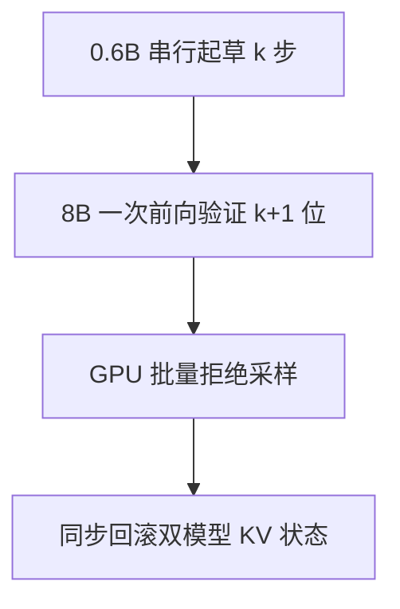

<div align="center">

# nano-vllm-speculative-decoding · 0.6B 独立小模型基线

基于 [nano-vLLM](https://github.com/GeeeekExplorer/nano-vllm) 的独立小模型（Qwen3-0.6B）批量投机解码实现。

**单请求 1.54× · 8 并发 1.21× · 32 并发 0.96× · 64 并发 0.82×**

[](https://github.com/tianyuantong/nano-vllm-speculative-decoding/actions/workflows/cpu-tests.yml?query=branch%3Abaseline%2Fqwen3-0.6b-draft)


[](LICENSE)

**简体中文** | [English](README.en.md) · [快速开始](#快速开始) · [完整结果](docs/v2/RESULTS.md) · [架构设计](docs/design/batched-speculative-decoding.md) · [主分支 (DFlash / DSpark) →](https://github.com/tianyuantong/nano-vllm-speculative-decoding/tree/main)

<picture>
  <source media="(prefers-color-scheme: dark)" srcset="docs/assets/speedup-06b-k128-dark.svg">
  
</picture>

</div>

> **分支说明**：本分支（`baseline/qwen3-0.6b-draft`）冻结并归档第一代 **Qwen3-0.6B 独立小模型**投机解码的完整源码、双模型 KV 调度与评测基线。演进后的 **DFlash 并行块式草稿、DSpark 与变长验证**位于 [`main` 分支](https://github.com/tianyuantong/nano-vllm-speculative-decoding/tree/main)，双卡 1P+1D 分离引擎位于 [`disagg/dual-gpu-1p1d` 分支](https://github.com/tianyuantong/nano-vllm-speculative-decoding/tree/disagg/dual-gpu-1p1d)。

基于 Qwen3-8B（target）+ Qwen3-0.6B（draft，k=3）与单卡 RTX PRO 6000（600 W）实测，通过标准拒绝采样保证输出分布与原模型严格一致。

| 并发请求数 | 0.6B 小模型 (k=3) | 每轮生成 token 数 | 相对普通解码 |
|---:|---|---|---|
| 1 | **1.54×** | 2.52 | 更快 |
| 8 | **1.21×** | 2.49 | 更快 |
| 32 | 0.96× | 2.53 | 被验证成本反超 |
| 64 | 0.82× | 2.53 | 被验证成本反超 |

表中为基于 NVIDIA [SPEED-Bench](https://huggingface.co/datasets/nvidia/SPEED-Bench)（约 1,000 token 长输入，涵盖大海捞针检索、代码补全、古典小说续写与创意写作）分层抽样的第一批 128 题留出测试集（对应左图）上，同一作业内相对普通解码的稳态吞吐倍数（3 个 seed 中位数；[`main` 分支](https://github.com/tianyuantong/nano-vllm-speculative-decoding/tree/main)采用互不重叠的第二批 128 题留出测试集）。右图展示了同源 48 题开发集（5 个 seed 中位数）在 1 / 2 / 4 / 8 / 16 / 32 / 64 并发下的完整衰减曲线（**1.47× → 1.42× → 1.32× → 1.17× → 1.03× → 0.94× → 0.79×**），盈亏拐点清晰落在 16 至 32 并发之间。各 seed 波动区间与阶段耗时见 [完整对照结果 →](docs/v2/RESULTS.md) · [初版评测报告 →](docs/v1/RESULTS.md)

## 性能拆解与瓶颈分析（为什么演进到块式草稿）

- **串行自回归起草占去整轮三分之一耗时。** Qwen3-0.6B（28 层）单步前向仅需读取 1.2 GB 权重（带宽理论下限 0.7 ms），但每步约 300 个算子的启动开销使单步实测耗时达 2.1–3.6 ms。每轮串行跑 k=3 步加上追赶步共耗时 6–13 ms（占整轮 19–31 ms 的三分之一以上），继续增大 k 得不偿失。
- **高并发下验证步算力成本反超。** Target 一次前向同时验证整批请求的 k+1 个候选位置；并发升至 16 时加速比收窄至 1.03×，32 并发起跌破 1×（0.94–0.96×）。
- **推动第二代块式草稿（[`main` 分支](https://github.com/tianyuantong/nano-vllm-speculative-decoding/tree/main)）。** 为消除多步自回归起草与双模型独立 KV 开销，第二代改用 5 层非因果块式草稿（DFlash），一次前向并行提出 7 个候选 token 并与 target 共用块表，在同一第一批 128 题留出测试集上将加速比提升至 **2.19× / 1.80× / 1.40× / 1.08×**（为本分支 0.6B 基线的 1.31–1.48 倍，见 [docs/v2/RESULTS.md](docs/v2/RESULTS.md)）；后续 DSpark 与变长验证结果位于 [`main` 分支](https://github.com/tianyuantong/nano-vllm-speculative-decoding/tree/main)。

## 核心实现

本分支将独立小模型起草、大模型单次前向验证与 GPU 批量拒绝采样接入 nano-vLLM 的调度循环：

- **双模型执行与独立 KV cache 管理**：调度器同时维护 target 与 draft 两套块表及显存池（`kv_cache_memory_bytes` 与 `draft_kv_cache_memory_bytes`），在请求预填充、token 接受、拒绝回滚与序列完成时同步更新双端 KV 状态（[`nanovllm/engine/scheduler.py`](nanovllm/engine/scheduler.py)）。
- **固定长度 CUDA Graph 验证**：每轮固定起草 k=3 个候选 token，按 batch size 补齐张量形状，跨轮复用 target 验证前向与 draft 自回归前向的 CUDA Graph（[`nanovllm/engine/speculative.py`](nanovllm/engine/speculative.py)）。
- **GPU 向量化拒绝采样**：候选概率、目标概率比对及残差分布重采样全部由 GPU 向量化算子（`SpecSampler`）整批处理，每轮仅做一次设备到主机（D2H）同步拷贝，采样阶段耗时压至 0.03–0.5 ms（[`nanovllm/layers/spec_sampler.py`](nanovllm/layers/spec_sampler.py)）。



## 正确性验证

候选 token 按标准拒绝采样验证：当 $u \lt \min(1, p_{\text{target}}(x) / p_{\text{draft}}(x))$ 时接受 $x$ ，否则从残差分布 $\text{normalize}(\max(p_{\text{target}} - p_{\text{draft}}, 0))$ 重采样，严格保持 target 输出分布。

GPU 实测覆盖四项检验：
- 采样器多步输出分布（29 个测试用例，总变差距离 ≤ 0.0031）
- 真实分布下的接受率与残差频率检验（实测接受率 0.453 对比解析值 0.456，最大频率偏差 0.0008）
- 验证步 logits 对比逐步 decode（最大绝对差 0.75，所有非平局位置 argmax 完全一致）
- GSM8K 数学推理数据集准确率（85.6% 对比普通解码 85.2%，差值 +0.4 个百分点，95% 置信区间 −0.8 ~ +1.6 个百分点）

## 快速开始

环境要求：Python 3.10–3.12，CUDA GPU（显存需容纳 Qwen3-8B、Qwen3-0.6B 及其各自的 KV cache）。

```bash
git clone -b baseline/qwen3-0.6b-draft https://github.com/tianyuantong/nano-vllm-speculative-decoding.git
cd nano-vllm-speculative-decoding
pip install torch triton flash-attn "transformers>=4.51" xxhash pytest
python -m pip install -e . --no-deps
```

填入本地模型路径即可运行：

```python
from nanovllm import LLM, SamplingParams

llm = LLM(
    "/models/Qwen3-8B",
    draft_model="/models/Qwen3-0.6B",
    num_speculative_tokens=3,
    max_num_seqs=8,
    enable_prefix_cache=False,
    kv_cache_memory_bytes=10 << 30,
    draft_kv_cache_memory_bytes=6 << 30,
    seed=0,
)
params = SamplingParams(temperature=0.7, top_k=20, top_p=0.8, max_tokens=256)

try:
    outputs = llm.generate(["Explain KV caching."], params)
    print(outputs[0]["text"])
finally:
    llm.exit()
```

省略 `draft_model` 和 `num_speculative_tokens` 即可切换为普通解码。
[模型配置与 API →](docs/DECODING.md)

## 复现

先从 NVIDIA SPEED-Bench 拉取并构建第一批 128 题留出测试集（`--panel K128`，48 题开发集为 `D48`），再在同一目录下跑完普通解码（`k0`）与 0.6B 投机解码（`model_k3`）的各并发及 seed：

```bash
python -m pytest -q    # CPU 测试
python tools/fetch_panels.py && python tools/build_panel_k128.py
for c in 1 8 32 64; do
  for s in 17011 110017 130031; do
    for line in k0 model_k3; do
      python bench_spec.py --mode closed-loop --protocol benchmarks/protocol-v2.json --panel K128 \
          --line "$line" --concurrency "$c" --seed "$s" --models-root /path/to/models \
          --commit "$(git rev-parse --short HEAD)" --output "runs/${line}_c${c}_s${s}.json"
    done
  done
done
python tools/report_v2.py --protocol benchmarks/protocol-v2.json --results runs
```

原始结果 JSON 与测试面板已打包在 Release 附件 [`results-batched-v1`](https://github.com/tianyuantong/nano-vllm-speculative-decoding/releases/tag/results-batched-v1) 与 [`results-dflash-dspark`](https://github.com/tianyuantong/nano-vllm-speculative-decoding/releases/tag/results-dflash-dspark) 中。

## 深入了解

| 文档 | 内容 |
|---|---|
| [架构设计](docs/design/batched-speculative-decoding.md) | 双模型执行、KV 状态管理、批处理与 CUDA Graph |
| [128 题测试集与 DFlash 对照](docs/v2/RESULTS.md) | 0.6B 对比 DFlash、单轮阶段耗时与正确性检验 |
| [初版结果](docs/v1/RESULTS.md) | 不同 batch size 与采样策略下的性能、阶段耗时与重复性 |
| [优化历程](docs/PERFORMANCE.md) | 第一版性能剖析，以及推动本次重写的主要瓶颈 |
| [使用指南](docs/DECODING.md) | 模型配置、采样参数与计时 API |

## 致谢

基于 [GeeeekExplorer/nano-vllm](https://github.com/GeeeekExplorer/nano-vllm) 构建，使用 [Qwen3](https://huggingface.co/Qwen/Qwen3-8B)、[FlashAttention](https://github.com/Dao-AILab/flash-attention) 与 [Triton](https://github.com/triton-lang/triton)。采样算法参考 Leviathan 等人的 *Fast Inference from Transformers via Speculative Decoding*（2023）与 Chen 等人的 *Accelerating Large Language Model Decoding with Speculative Sampling*（2023）。
[上游版本与项目历史 →](docs/UPSTREAM.md)

## 许可

[MIT](LICENSE)。
