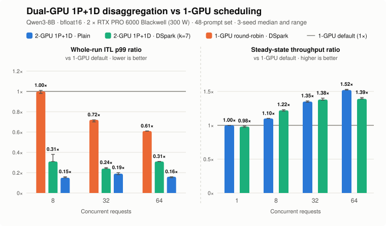
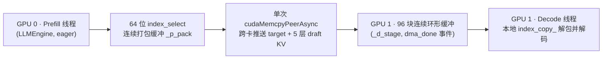

<div align="center">

# nano-vllm-speculative-decoding · 双卡 1P+1D Prefill-Decode 分离

基于 [nano-vLLM](https://github.com/GeeeekExplorer/nano-vllm) 的单进程双线程双卡 Prefill-Decode 分离引擎：连续环形缓冲单次点对点（Peer-to-Peer，P2P）推送，同时支持普通解码与 DSpark 块式投机解码。

**8–64 并发全程 token 间延迟（ITL）p99：普通解码 0.15–0.19× · DSpark 0.24–0.31× ｜ 32–64 并发稳态吞吐：普通解码 1.35–1.52× · DSpark 1.38–1.39×**

[](https://github.com/tianyuantong/nano-vllm-speculative-decoding/actions/workflows/cpu-tests.yml)


[](LICENSE)

**简体中文** | [English](README.en.md) · [快速开始](#快速开始) · [双卡详细结果](docs/RESULTS.md#12-dual-gpu-prefill-decode-disaggregation-1p1d) · [主分支 (DFlash / DSpark) →](https://github.com/tianyuantong/nano-vllm-speculative-decoding/tree/main)

<picture>
  <source media="(prefers-color-scheme: dark)" srcset="docs/assets/pd-1p1d-overview-dark.svg">
  
</picture>

</div>

> **分支说明**：本分支（`disagg/dual-gpu-1p1d`）承载双卡 1P+1D Prefill-Decode 分离引擎（[`DisaggLLM`](nanovllm/disagg/disagg_engine.py) 与 [`KVCacheTransfer`](nanovllm/disagg/kv_transfer.py)）及双卡评测工具。单卡四代投机解码演进（DFlash、DSpark 与变长验证）位于 [`main` 分支](https://github.com/tianyuantong/nano-vllm-speculative-decoding/tree/main)，0.6B 独立小模型基线位于 [`baseline/qwen3-0.6b-draft` 分支](https://github.com/tianyuantong/nano-vllm-speculative-decoding/tree/baseline/qwen3-0.6b-draft)。

基于 Qwen3-8B 与同节点 2 × RTX PRO 6000（300 W，PCIe P2P 直传），在 NVIDIA [SPEED-Bench](https://huggingface.co/datasets/nvidia/SPEED-Bench)（约 1,000 token 长输入，涵盖大海捞针检索、代码补全、古典小说续写与创意写作）48 题开发集上闭环实测，对照同一物理节点上的单卡默认调度与单卡轮流 prefill（3 个 seed 中位数，在途请求数保持一致 `prefetch = 0`）：

| 解码模式 | 并发请求数 | 全程 ITL p99 (默认 → 1P+1D) | 1P+1D 比值 | 单卡轮流比值 | 稳态吞吐 (默认 → 1P+1D) | 双卡吞吐比值 | 每卡 |
|---|---:|---|---|---|---|---|---|
| 普通解码 | 1 | 12.4 → 12.3 ms | 1.00× | — | 82 → 82 tok/s | 1.00× | 0.50× |
| 普通解码 | 8 | 88.3 → 13.3 ms | **0.15×** | 1.00× | 545 → 601 tok/s | 1.10× | 0.55× |
| 普通解码 | 32 | 97.5 → 18.1 ms | **0.19×** | 0.99× | 1,329 → 1,800 tok/s | **1.35×** | 0.68× |
| 普通解码 | 64 | 147.9 → 23.6 ms | **0.16×** | 0.71× | 1,814 → 2,764 tok/s | **1.52×** | 0.76× |
| DSpark (k=7) | 1 | 17.3 → 17.4 ms | 1.01× | — | 165 → 164 tok/s | 0.98× | 0.49× |
| DSpark (k=7) | 8 | 101.1 → 31.6 ms | **0.31×** | 1.00× | 867 → 1,053 tok/s | 1.22× | 0.61× |
| DSpark (k=7) | 32 | 182.9 → 44.8 ms | **0.24×** | 0.72× | 1,488 → 2,060 tok/s | **1.38×** | 0.69× |
| DSpark (k=7) | 64 | 264.5 → 81.4 ms | **0.31×** | 0.61× | 1,660 → 2,307 tok/s | **1.39×** | 0.70× |

表中 `ITL`（Inter-Token Latency，token 间延迟）为单条请求相邻两次交付的主机时钟间隔；各 seed 波动区间与后到请求分项指标见 [RESULTS.md §12](docs/RESULTS.md#12-dual-gpu-prefill-decode-disaggregation-1p1d)。

## 收益拆解与工程取舍

- **为什么用 1P+1D 而不是起两个单卡副本：消除 decode 侧的 prefill 停顿。** 32–64 并发下两张卡折合每卡稳态吞吐为单卡的 0.68–0.76×（纯看总吞吐不如双副本），但双副本仍会在各自卡内因新请求 prefill 暂停在跑解码批次。将 prefill 彻底剥离至 `cuda:0` 后，64 并发下全程最长单次交付间隔在普通解码上从 3.37 s 压至 0.27 s（0.08×），在 DSpark 上从 3.52 s 压至 0.40 s（0.11×，单卡轮流 prefill 为 1.00×）；后到请求在解码卡上的轮间最长间隔贴合单轮耗时（普通解码 25 ms，DSpark 81 ms）。
- **对比单卡轮流 prefill。** 单卡轮流 prefill 无需额外硬件即可把 32–64 并发下 DSpark 的 ITL p99 压至 0.61–0.72×，但解码步之间仍夹着单条 prompt 的 prefill 耗时；双卡 1P+1D 将 DSpark 全程 ITL p99 再砍一半至 0.24–0.31×，普通解码直接压至 0.15–0.19×（8–64 并发下仅 13.3–23.6 ms）。
- **后到请求的首 token 延迟（Time To First Token，TTFT）。** 普通解码在 8 / 32 / 64 并发下，后到请求的 TTFT p99 降至单卡默认调度的 0.90× / 0.67× / 0.38×（单卡轮流 prefill 升至 1.28–1.33×）。DSpark 在 8、32 并发下为 1.06×、1.32×；64 并发下因解码卡在 0.99 s 提前开跑，前 5 条短请求在初始 64 条 prefill 波（4.90 s 结束）排空前已完成，闭环立刻补进的第 64..68 号请求排在初始波末尾等待 1.9–3.0 s，使全部后到请求的 TTFT p99 升至 1,934 ms（默认调度的 7.06×）；初始波排空后的第 70..287 号请求 TTFT p99 回落至 297–391 ms（单卡默认 274 ms，轮流 prefill 510 ms）。
- **预取裕量（`prefetch = 2`）。** 主表固定 `prefetch = 0` 以对齐单卡在途请求数；若允许 `cuda:0` 提前预填充 2 条请求，32 与 64 并发下 DSpark 稳态吞吐升至 1.44× 与 1.47×，代价是请求在环形缓冲区的交接等待中位数增至 30–174 ms。

## 核心实现

本分支在单个 Python 进程内组合一个只跑 prefill 的 `LLMEngine`（`cuda:0`，eager 模式）与一个只跑 decode / 投机验证的 `LLMEngine`（`cuda:1`，启用 CUDA Graph），核心模块约 760 行：



- **单向推送式连续环形缓冲交接（[`nanovllm/disagg/kv_transfer.py`](nanovllm/disagg/kv_transfer.py)）**：`KVCacheTransfer` 同时搬运 36 层 target KV 与 5 层 DSpark 辅助上下文 KV。`threading.Lock` 仅保护环形缓冲槽位与在途队列的 CPU 簿记，所有 GPU 打包、跨卡拷贝与解包均在锁外执行；源端事件记在 `cuda:0` 流供 prefill 线程独立回收块，目标端 `dma_done` 事件记在 `cuda:1` 流，decode 线程全程不调用 `cuda:0`。
- **双线程流水线编排（[`nanovllm/disagg/disagg_engine.py`](nanovllm/disagg/disagg_engine.py)）**：`DisaggLLM` 在 decode 侧仅当 `dma_done.query()` 就绪且 `cuda:1` 剩余块数足以容纳首轮投机验证时，才分配目标块并在 `d_stream` 本地解包接纳，新请求传输期间不阻塞已在跑批次。
- **同进程多设备底层隔离（[`context.py`](nanovllm/utils/context.py)、[`model_runner.py`](nanovllm/engine/model_runner.py)）**：将注意力上下文改为 `threading.local()` 线程局部存储，为每个实例分配本卡独立的 CUDA Graph `capture_stream`、随机数生成器与 `HashStore` 单卡通信组，并在模型构建前清理 RoPE `@lru_cache` 跨卡缓存。

## 正确性核对

双卡冒烟检验（[`tools/smoke_pd.py`](tools/smoke_pd.py)）覆盖三项不变量：
- **串行 1P+1D 对齐单引擎**：普通解码与 DSpark 两条线在串行步模式下与单卡 `LLM` 输出逐 token 完全一致。
- **双线程对齐按轮次重放**：双卡异步交接会改变请求进入 decode 的轮次与批次大小，因此双线程模式不声称与单引擎逐 token 相同；按双线程实测进批轮次在串行路径重放后，输出逐 token 一致。
- **物理块与环槽完整回收**：运行结束后 P、D 双端 `BlockManager` 空闲块均为 `113 / 113`，零泄漏；压测作业与同节点单卡对照作业的 18 次默认调度运行逐 token 一致。

## 踩过的坑

- **64 并发下跨线程设备等待与 `> 2 GiB` KV 逐块拷贝拆核**：早期由 decode 线程跨卡拉取离散 KV 块时，64 并发下 `3/3` 次运行在起步前 3.6 s 内无法启动首轮解码，稳态普通解码偶发 891–1,035 ms 停顿，DSpark 后到请求 ITL p99 停在 0.54–0.65×（102–169 ms）。源码路径与步时间线指向两处交互：① prefill 线程步末 `.tolist()` 同步拷贝结果期间（64 并发一批约 900 ms）持有 `cuda:0` 运行时上下文锁（`CUcontext`），每批仅开头约 9.5–12.6 ms 尚未进入 `.tolist()`，decode 线程跨卡拉取块或析构 `cuda:0` 事件即会被阻塞；② 64 并发下 KV 池达 25.5 GiB（`> 2³¹` 字节），单块跨层切片偏移超出 32 位有符号整数上限，触发 PyTorch `TensorIterator` 将**每块** `copy_` 拆成 16 个 kernel（一批 14 条请求约 68 块共发射约 1,088 次 kernel，越过发射窗口）。改为在 prefill 线程做 `int64` 连续打包与单次 `cudaMemcpyPeerAsync` 推送、decode 线程不碰 `cuda:0` 后，64 并发起步等待降为 `0/3`，普通解码轮间最长间隔从 891–1,035 ms 降至 25 ms，DSpark 全程 ITL p99 降至 44.8–81.4 ms（0.24–0.31×）。
- **同进程双卡捕获 CUDA Graph 与全局缓存串卡**：PyTorch `torch.cuda.graph` 的默认捕获流在整个进程只有一条，不在第二张卡显式传入 `cuda:1` 专属 `capture_stream` 会触发 Triton 设备指针报错；同时 `get_rope` 的 `@lru_cache` 会把 `cuda:0` 上的旋转位置编码张量复用到 `cuda:1`。
- **解码流直接等待跨卡拷贝事件会拖慢整批请求**：早期让 `d_stream` 直接 `wait_event(copy_done)`，导致每次交接时整批在跑请求一起等待 PCIe 传输；改为在主机端轮询 `dma_done.query()` 就绪后再接纳解包，解耦传输与解码步。

## 快速开始

环境要求：Python 3.10–3.12，同节点 2 张支持 P2P 访问的 CUDA GPU（传入相同设备号时亦可在单卡双流下做功能验证，需显式指定 `kv_cache_memory_bytes`）。

```bash
git clone -b disagg/dual-gpu-1p1d https://github.com/tianyuantong/nano-vllm-speculative-decoding.git
cd nano-vllm-speculative-decoding
pip install torch triton flash-attn "transformers>=4.51" xxhash pytest
python -m pip install -e . --no-deps
```

参照 [`tools/smoke_pd.py`](tools/smoke_pd.py) 在集群双卡上验证过的调用方式启动 `DisaggLLM`：

```python
from nanovllm import SamplingParams
from nanovllm.disagg import DisaggLLM

disagg = DisaggLLM(
    "/models/Qwen3-8B",
    prefill_device=0,
    decode_device=1,
    draft_model="/models/dspark_qwen3_8b_block7",    # 省略 draft_model 与 draft_type 即为普通解码
    draft_type="dspark",
    max_num_seqs=8,
    max_model_len=1024,
    enable_prefix_cache=False,
    kv_cache_memory_bytes=4 << 30,
    seed=0,
)
params = SamplingParams(temperature=0.0, max_tokens=64)

try:
    outputs = disagg.generate(["Explain KV caching in two sentences."], params, threaded=True)
    print(outputs[0]["text"])
finally:
    disagg.exit()
```

## 复现

先跑 CPU 单元测试与双卡冒烟检验，再在 48 题 SPEED-Bench 开发集（`--panel D48`）上运行普通解码（`k0`）与 DSpark（`dspark_k7`）的单卡默认调度与双卡 1P+1D 背靠背闭环压测：

```bash
python -m pytest -q    # CPU 测试（含 DisaggLLM 与环形缓冲回绕单测）
python tools/fetch_panels.py
python tools/smoke_pd.py --models-root /path/to/models --dspark-dir dspark_qwen3_8b_block7 \
    --prefill-device 0 --decode-device 1 --kv-gb 4 --output runs/smoke_2gpu.json

for s in 17011 110017 130031; do
  python tools/bench_pd.py --protocol benchmarks/protocol-v2.3.json --panel D48 \
      --lines k0 dspark_k7 --concurrencies 1 8 32 64 --seed "$s" \
      --prefill-device 0 --decode-device 1 --prefetches 0 2 \
      --models-root /path/to/models --output "runs/bench_pd_s${s}.json"
done
```

双卡 72 次正式运行、修改前 72 次对照运行、同节点单卡轮流 prefill 基线及汇总脚本均打包在 Release 附件 [`results-pd-disagg`](https://github.com/tianyuantong/nano-vllm-speculative-decoding/releases/tag/results-pd-disagg) 中。

## 深入了解

| 文档 / 模块 | 内容 |
|---|---|
| [双卡 1P+1D 完整结果](docs/RESULTS.md#12-dual-gpu-prefill-decode-disaggregation-1p1d) | 吞吐、全程与后到请求 ITL / TTFT 分位数及跨线程停顿修复对比 |
| [`nanovllm/disagg/`](nanovllm/disagg/) | `DisaggLLM` 双线程流水线编排与 `KVCacheTransfer` 连续环形缓冲 P2P 传输 |
| [`tools/smoke_pd.py`](tools/smoke_pd.py) · [`tools/bench_pd.py`](tools/bench_pd.py) | 双卡正确性与块回收冒烟闸门、同作业单卡对照与双卡闭环压测驱动 |
| [单卡轮流 prefill 结果](docs/RESULTS.md#9-round-robin-prefill) | 零额外硬件下的单卡尾延迟治理对照 |
| [主分支 README](https://github.com/tianyuantong/nano-vllm-speculative-decoding/tree/main) | 单卡四代投机解码演进（0.6B → DFlash → DSpark → 变长验证） |

## 致谢

基于 [GeeeekExplorer/nano-vllm](https://github.com/GeeeekExplorer/nano-vllm) 构建，单进程双线程异步交接骨架参考 [nanoPD](https://github.com/HJCheng0602/nanoPD)，DSpark 权重来自 [DeepSpec](https://github.com/deepseek-ai/DeepSpec)，基座模型使用 [Qwen3](https://huggingface.co/Qwen/Qwen3-8B)。
[上游版本与项目历史 →](docs/UPSTREAM.md)

## 许可

[MIT](LICENSE)。
