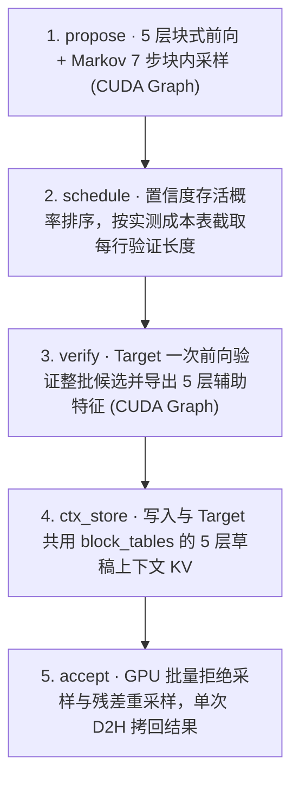

<div align="center">

# nano-vllm-speculative-decoding

基于 [nano-vLLM](https://github.com/GeeeekExplorer/nano-vllm) 的块式投机解码：从 0.6B 独立小模型演进至 DFlash 并行草稿、DSpark 块内 Markov 修正与变长验证。

**变长 DSpark：单请求 2.02× · 8 并发 1.79× · 32 并发 1.48× · 64 并发 1.25×**

[](https://github.com/tianyuantong/nano-vllm-speculative-decoding/actions/workflows/cpu-tests.yml)


[](LICENSE)

**简体中文** | [English](README.en.md) · [核心实现](#核心实现四代架构演进) · [性能拆解](#性能拆解与系统扩展) · [快速开始](#快速开始) · [完整结果](docs/RESULTS.md) · [使用指南](docs/DECODING.md)

<picture>
  <source media="(prefers-color-scheme: dark)" srcset="docs/assets/speedup-overview-dark.svg">
  
</picture>

</div>

基于 Qwen3-8B 与单卡 RTX PRO 6000（600 W）实测，通过标准拒绝采样保证输出分布与原模型严格一致：

| 并发请求数 | 0.6B 小模型 (k=3) | DFlash (k=7) | DSpark 定长 (k=7) | DSpark 变长 |
|---:|:---:|:---:|:---:|:---:|
| 1 | 1.50× | 1.98× | **2.08×** | 2.02× |
| 8 | 1.21× | 1.66× | 1.76× | **1.79×** |
| 32 | 1.00× | 1.31× | 1.44× | **1.48×** |
| 64 | 0.85× | 1.02× | 1.14× | **1.25×** |

表中为基于 NVIDIA [SPEED-Bench](https://huggingface.co/datasets/nvidia/SPEED-Bench)（约 1,000 token 长输入，涵盖大海捞针检索、代码补全、古典小说续写与创意写作）分层抽样的同一套 128 题留出测试集上，在 Colab G4（RTX PRO 6000，600 W）相对普通解码的稳态吞吐倍数（3 个 seed 中位数；定长每轮平均产出 token 数为 DFlash 2.53–2.70、DSpark 2.81–2.95，变长每请求每轮验证位置数随并发从 8.00 动态缩至 4.43）。各 seed 波动区间与分项指标见 [完整数据与评测协议 →](docs/RESULTS.md)

## 核心实现（四代架构演进）

当前主分支引擎不到 3,000 行 Python，沿四代递进演进：

- **第一代：0.6B 独立小模型（归档于 [`baseline/qwen3-0.6b-draft`](https://github.com/tianyuantong/nano-vllm-speculative-decoding/tree/baseline/qwen3-0.6b-draft)）**：双模型独立维护各自的块表与 KV cache，draft 串行自回归起草 k=3 步，target 通过固定长度 CUDA Graph 一次前向验证，并在 GPU 上用向量化采样器（`SpecSampler`）完成整批拒绝采样与回滚。
- **第二代：DFlash 块式并行草稿**：移除独立小模型与双份块表，复用 decode 注意力路径一次跑 7 个 query 的非因果注意力，直接读取 target 的 5 层辅助特征；5 层 draft KV cache 与 target 共用同一张块表（`block_tables`），在验证后写入已接受位置的上下文 K/V。
- **第三代：DSpark 块内 Markov 修正**：在 DFlash 块特征之上通过 Markov head 由左向右依次采样 7 个位置，并以叠加偏置后的分布参与拒绝采样验证；全程由三段 CUDA Graph 覆盖（target 验证前向、draft 块前向、DSpark 7 步块内采样）。
- **第四代：变长验证**：利用 DSpark 置信度头计算各位置的存活概率（校准后置信度的前缀积），结合实测轮时长表在整批内按估算吞吐增量决定每行验证长度，并将总验证位置数向上对齐至 CUDA Graph 档位，同时保持无损拒绝采样。



核心代码入口：[`speculative.py`](nanovllm/engine/speculative.py)（`SpeculativeDecoder.run_round`、`DFlashDrafter.propose` 与 `after_verify`）、[`verify_schedule.py`](nanovllm/engine/verify_schedule.py)（`VerifySchedule.verify_lengths`）、[`dflash.py`](nanovllm/models/dflash.py)（`_markov_rows`）、[`spec_sampler.py`](nanovllm/layers/spec_sampler.py) 与 [`attention.py`](nanovllm/layers/attention.py) 的 decode 分支。

## 性能拆解与系统扩展

- **块式草稿消除串行自回归开销。** 独立 0.6B 模型每轮串行跑 3 步 decode（约 6 ms）并维护独立 KV cache，并发升至 32 时被验证成本追平（1.00×），64 并发跌至 0.85×；块式 draft 一次前向同时提出 7 个候选 token，大幅压低起草耗时。
- **DSpark 靠 Markov head 拉高接受率。** 每轮产出 token 数比 DFlash 高 7%–12%（2.81–2.95 对比 2.53–2.70）。在 32–64 并发下，仅在 top-k 候选窗口内采样还省去了全词表 softmax 开销（占领先幅度的 2–6 个百分点）。
- **变长验证削减高并发验证成本。** Target 验证步约占单轮耗时的四分之三，且每请求验 8 位相比验 1 位在 16、32、64 并发下使单轮耗时增加 14%、25% 与 49%。开启变长验证后，32 与 64 并发下每请求每轮仅验 4.62 与 4.43 个位置；64 并发下单轮验证耗时从 36.51 ms 降至 27.96 ms、接受步从 4.31 ms 降至 2.45 ms，单轮总耗时缩短 18.6% 而每轮仅少产出 5.6% 的 token，解码轮净吞吐提升 +16.1%，计入 prefill 停顿后整体稳态吞吐比定长提升 **+2.2%**（1.48×）与 **+8.9%**（1.25×；单请求下每轮均验满 8 位、输出逐 token 一致，2.7% 回落来自置信度与调度固定开销，[详情](docs/RESULTS.md#8-variable-length-verification)）。
- **轮流 prefill 缩短单卡停顿。** 本引擎 prefill 步会暂停 decode（32 并发下占去 DSpark 稳态窗口 31% 时间）。打开 `round_robin_prefill=True`（默认关闭）后，单步只放进一条新请求并紧跟一步 decode：单条请求相邻交付最长间隔从 1.1 s 降至 70–110 ms，32–64 并发下 DSpark 的 token 间延迟（Inter-Token Latency，ITL）p99 降至默认调度的 0.58–0.73 倍，稳态吞吐保持 0.97–1.00 倍，代价是中途到达请求的首 token 延迟（Time To First Token，TTFT）p99 升至 1.0–3.8 倍（[结果](docs/RESULTS.md#9-round-robin-prefill)）。
- **同机对比 vLLM**（48 题 SPEED-Bench 开发集，5 个 seed，全流程挂钟吞吐，vLLM `372477d`）：跑 DSpark 时，1–32 并发下比 vLLM 慢 5.8%–8.2%，单轮多出的时间集中在 draft 一侧；关闭投机时，两者相差不到 2%（[结果](docs/RESULTS.md#4-against-vllm-d48-wall-clock-toks)）。

围绕高并发停顿、算子带宽下限与共享前缀，仓库还完成了三项系统扩展实测：

| 方向 | 核心实测结论 | 代码与数据入口 |
|---|---|---|
| **双卡 1P+1D 分离** | 同节点双卡解耦 prefill 与 decode：8–64 并发下全程 ITL p99 普通解码降至单卡默认的 **0.15–0.19×**（13.3–23.6 ms）、DSpark 降至 **0.24–0.31×**（31.6–81.4 ms，32–64 并发下约为单卡轮流 prefill 的一半）；32–64 并发稳态吞吐分别为单卡的 **1.35–1.52×** 与 **1.38–1.39×**（每卡 0.68–0.76× 与 0.69–0.70×）。 | [`disagg/dual-gpu-1p1d` 分支](https://github.com/tianyuantong/nano-vllm-speculative-decoding/tree/disagg/dual-gpu-1p1d) · [结果 §12](docs/RESULTS.md#12-dual-gpu-prefill-decode-disaggregation-1p1d) · [数据包](https://github.com/tianyuantong/nano-vllm-speculative-decoding/releases/tag/results-pd-disagg) |
| **Roofline 与手写 Triton 算子** | 普通解码的矩阵乘与注意力实测达高带宽显存（HBM）读带宽（1.52 TB/s）的 78%–95%，而 8-query 验证注意力因未打包分组查询注意力（GQA）跌至 39%–61%；手写前缀切分注意力与稀疏候选分块拒绝采样 Triton 算子，将变长 DSpark 满批单轮耗时在 32–64 并发下缩短 **10.6%–13.9%**，在约 3k 上下文 64 并发下缩短 **31.4%**（73.5 → 50.5 ms）。 | [结果 §10](docs/RESULTS.md#10-speed-of-light-roofline-and-hand-written-triton-kernels) · [Roofline 包](https://github.com/tianyuantong/nano-vllm-speculative-decoding/releases/tag/results-verify-attention) · [算子包](https://github.com/tianyuantong/nano-vllm-speculative-decoding/releases/tag/results-fused-kernels) |
| **前缀缓存交互** | 在 512–2,048 token 共享前缀下，开启前缀缓存使 8–64 并发各线稳态吞吐提升 **4%–70%**、稳态 TTFT p50 降至 **51–59 ms**；因共享物理 KV 块对 1-query 普通解码提速大于 8-query 验证，前缀达 1,024–2,048 token 时，投机相对加速比在 32 并发下收窄 6%–12%、64 并发下收窄 2%–8%。 | [结果 §11](docs/RESULTS.md#11-prefix-caching-with-speculative-decoding) · [数据包](https://github.com/tianyuantong/nano-vllm-speculative-decoding/releases/tag/results-prefix-cache) |

## 正确性验证

候选 token 按标准拒绝采样验证：当 $u \lt \min(1, p_{\text{target}}(x) / p_{\text{draft}}(x))$ 时接受 $x$ ，否则从残差分布 $\text{normalize}(\max(p_{\text{target}} - p_{\text{draft}}, 0))$ 重采样，输出分布与原模型严格一致（DSpark 中 $p_{\text{draft}}$ 取每行叠加 Markov 偏置后的分布）。

GPU 实测覆盖四项检验：
- 采样器多步输出分布（29 个测试用例）
- DSpark 块输出与 Markov 修正后 logits 对比参考实现 DeepSpec（相对误差 0.59%–1.08%）
- 验证步 logits 对比逐步 decode（最大绝对差 0.84；变长验证 288 行非平局位置 argmax 全一致）
- GSM8K 数学推理数据集准确率：定长 84.7% 对比普通解码 85.2%（差值 −0.5 个百分点，95% 置信区间 −1.7 ~ +0.8）；变长 84.2% 对比 85.1%（差值 −0.87 个百分点，95% 置信区间 −2.14 ~ +0.40）

在 DSpark 论文自己的题目和采样设置下，本引擎复现了论文 Table 1 的每轮 token 数：DFlash 4.10、DSpark 4.80，论文为 4.07、4.81（9 个数据集，3,030 道题；[详情](docs/RESULTS.md#53-tokens-per-round-against-the-dspark-paper)）。

## 踩过的坑

- **fp32 下原地改写输入**：输入已经是 fp32 时，`x.float()` 直接返回原张量引用，导致上游 RMSNorm 原地修改了输入张量。bf16 路径不受影响，该问题在 fp32 下与 DeepSpec 对齐数值时暴露。
- **`torch.compile` 重编译回退**：默认重编译上限（8 次）耗尽后，新形状会回退到未编译路径，破坏 CUDA Graph 与 eager 模式的逐位一致性；将上限调至 64 后恢复。
- **vLLM 基线对齐**：vLLM（`372477d`）默认对 draft 做 greedy 采样，且 DeepSpec 的 DFlash 权重需走其 `dspark` 路径以匹配块布局；对照测试时已将其统一改为同分布随机采样。
- **多 query 验证时 GQA 打包失效**：`flash_attn_with_kvcache` 仅在 `q_len == 1` 时将每个 KV head 对应的 4 个 query head 打包进同一个 tile；每请求一次验证 8 个候选位置时会退出打包路径，导致验证注意力仅跑出可达 HBM 读带宽的 39%–61%（[详情](docs/RESULTS.md#10-speed-of-light-roofline-and-hand-written-triton-kernels)）。

## 快速开始

环境要求：Python 3.10–3.12，CUDA GPU（显存需容纳 target 与 draft 模型及其 KV cache）。

```bash
git clone https://github.com/tianyuantong/nano-vllm-speculative-decoding.git
cd nano-vllm-speculative-decoding
pip install torch triton flash-attn "transformers>=4.51" xxhash pytest
python -m pip install -e . --no-deps
```

填入本地模型路径即可运行：

```python
from nanovllm import LLM, SamplingParams

llm = LLM(
    "/models/Qwen3-8B",
    draft_model="/models/dspark_qwen3_8b_block7",    # deepseek-ai/dspark_qwen3_8b_block7
    draft_type="dspark",
    max_num_seqs=8,
    enable_prefix_cache=False,
    kv_cache_memory_bytes=10 << 30,
    seed=0,
)
params = SamplingParams(temperature=0.7, top_k=20, top_p=0.8, max_tokens=256)

try:
    outputs = llm.generate(["Explain KV caching."], params)
    print(outputs[0]["text"])
finally:
    llm.exit()
```

DSpark 与 DFlash 每轮固定提出 7 个候选 token（由权重块大小决定），无需设置 `num_speculative_tokens`。`kv_cache_memory_bytes` 按 target 层数分配块预算，5 层 draft KV 共用同一张块表、在预算外独立分配。切换 DFlash 时传入 `draft_model="/models/dflash_qwen3_8b_block7"` 与 `draft_type="dflash"`；普通解码省略 `draft_model` 即可。0.6B 独立小模型与双卡 1P+1D 分离分别位于 [`baseline/qwen3-0.6b-draft`](https://github.com/tianyuantong/nano-vllm-speculative-decoding/tree/baseline/qwen3-0.6b-draft) 与 [`disagg/dual-gpu-1p1d`](https://github.com/tianyuantong/nano-vllm-speculative-decoding/tree/disagg/dual-gpu-1p1d) 分支。
[模型配置与 API →](docs/DECODING.md)

## 复现

先从 NVIDIA SPEED-Bench 拉取并构建评测面板（`D48` 为 48 题开发集，`K128` / `K128b` 为两批互不重叠的 128 题留出测试集），再在同一目录下跑完普通解码（`k0`）与投机解码（`dflash_k7`、`dspark_k7`）的各并发及 seed：

```bash
python -m pytest -q    # CPU 测试，30 秒内
python tools/fetch_panels.py && python tools/build_panel_k128.py
for c in 1 8 32 64; do
  for s in 17011 110017 130031; do
    for line in k0 dflash_k7 dspark_k7; do
      python bench_spec.py --mode closed-loop --protocol benchmarks/protocol-v2.1.json --panel K128b \
          --line "$line" --concurrency "$c" --seed "$s" --models-root /path/to/models \
          --commit "$(git rev-parse --short HEAD)" --output "runs/${line}_c${c}_s${s}.json"
    done
  done
done
python tools/report_v2.py --protocol benchmarks/protocol-v2.1.json --results runs
```

变长验证改用 `benchmarks/protocol-v2.3.json`，评测线为 `k0 dspark_k7 dspark_var`。`tools/report_v2.py` 汇总吞吐与加速比，`tools/gain_factors.py` 拆解各因素贡献，`tools/plot_speedup.py` 生成加速比柱状图。各表对应的原始结果 JSON 与测试面板打包在 [`results-dflash-dspark`](https://github.com/tianyuantong/nano-vllm-speculative-decoding/releases/tag/results-dflash-dspark) 与 [`results-variable-length`](https://github.com/tianyuantong/nano-vllm-speculative-decoding/releases/tag/results-variable-length) 等 [Releases](https://github.com/tianyuantong/nano-vllm-speculative-decoding/releases) 附件中。

文档索引：[完整结果与协议](docs/RESULTS.md) · [DFlash 对照 0.6B](docs/v2/RESULTS.md) · [使用指南](docs/DECODING.md) · [评测工具说明](tools/README.md) · [0.6B 架构设计](docs/design/batched-speculative-decoding.md) · [早期性能剖析](docs/PERFORMANCE.md)

## 致谢

基于 [GeeeekExplorer/nano-vllm](https://github.com/GeeeekExplorer/nano-vllm) 构建。DFlash 块式草稿设计源自 [DFlash](https://github.com/z-lab/dflash)（[arXiv:2602.06036](https://arxiv.org/abs/2602.06036)），DSpark 源自 DeepSeek（[arXiv:2607.05147](https://arxiv.org/abs/2607.05147)）；两份 draft 权重及对齐所用的参考实现均来自 [DeepSpec](https://github.com/deepseek-ai/DeepSpec)。基座模型使用 [Qwen3](https://huggingface.co/Qwen/Qwen3-8B)，底层算子基于 [FlashAttention](https://github.com/Dao-AILab/flash-attention) 与 [Triton](https://github.com/triton-lang/triton)。采样算法参考 Leviathan 等人的 *Fast Inference from Transformers via Speculative Decoding*（2023）与 Chen 等人的 *Accelerating Large Language Model Decoding with Speculative Sampling*（2023）。
[上游版本与项目历史 →](docs/UPSTREAM.md)

## 许可

[MIT](LICENSE)。
