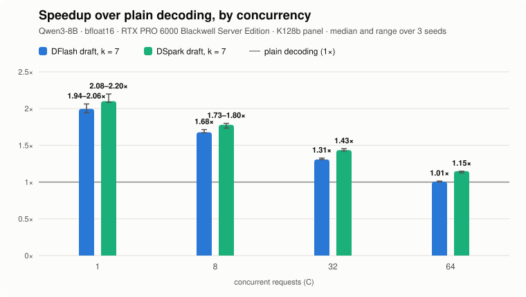

<div align="center">

# nano-vllm-speculative-decoding

Speculative decoding for [nano-vLLM](https://github.com/GeeeekExplorer/nano-vllm): a separate draft model, the DFlash block draft, and DSpark's Markov-corrected blocks.

**2.08–2.20× at C=1 · 1.73–1.80× at C=8 · 1.43× at C=32 · 1.15× at C=64**

[](https://github.com/tianyuantong/nano-vllm-speculative-decoding/actions/workflows/cpu-tests.yml)


[](LICENSE)

**English** | [简体中文](README.zh.md) · [Quick start](#usage) · [Results](docs/RESULTS.md) · [Design](docs/design/batched-speculative-decoding.md)

<picture>
  <source media="(prefers-color-scheme: dark)" srcset="docs/assets/speedup-k128b-dark.svg">
  
</picture>

</div>

DSpark draft on Qwen3-8B, RTX PRO 6000. Lossless in distribution (verified); GSM8K accuracy within −1.7…+0.8 pt.

Measured: steady-state tok/s against plain decoding in the same engine, on an unseen 128-prompt panel, 3 seeds per concurrency, median (min–max). DSpark is faster than DFlash at every concurrency; at C=32–64, at least 2–6 points of that lead come from DSpark's cheaper sampling path. Against vLLM's DSpark with the same weights on the same GPU model (dev build `372477d`, dev panel, wall-clock): 7.6–7.9% behind at C=1–32. [Protocol, gates, open questions →](docs/RESULTS.md)

| C | DFlash (k=7) | DSpark (k=7) | DSpark ÷ DFlash | tokens per round (DFlash / DSpark) |
|---:|---|---|---|---|
| 1 | 1.94–2.06× | 2.08–2.20× | 1.07 (1.04–1.08) | 2.59 / 2.82 |
| 8 | 1.68× (1.67–1.71) | 1.73–1.80× | 1.01–1.08 | 2.53 / 2.81 |
| 32 | 1.31× (1.31–1.33) | 1.43× (1.42–1.45) | 1.10 (1.09–1.10) | 2.70 / 2.95 |
| 64 | 1.01× (1.00–1.01) | 1.15× (1.13–1.15) | 1.14 (1.11–1.15) | 2.65 / 2.93 |

The gain shrinks with C because verification cost per row climbs at high concurrency, and prefill steps, which pause decoding in this engine, take 31% of DSpark's steady state at C=32. DSpark stays faster than plain decoding at C=64, where DFlash is not. The 0.6B draft and DFlash on the earlier K128 panel are in [the DFlash results](docs/v2/RESULTS.md).

## What this adds

Two block drafts on top of the 0.6B-draft release.

**DFlash**: 434 lines added, 107 removed, in 12 engine files.
- The draft block — the last committed token plus 6 mask tokens — runs as one 7-query, non-causal attention pass through the decode path.
- The target exports the hidden states (hidden + residual) of 5 layers during prefill and verification.
- Context K/V for all 8 verified positions are written right after verification; a rejected position is overwritten by the next block before anything reads it.
- The draft shares the target's block table and pad block, so there is no second KV allocator.
- Two CUDA graphs: verification (also exporting the 5 layers) and the draft block forward.

**DSpark**, on the DFlash draft: 217 lines added, 12 removed, in 4 engine files (the engine is now 2,832 lines).
- A Markov head adds to row j's logits a low-rank bias of the token drawn at row j−1 (the last committed token for row 0), so the 7 drafts are drawn left to right.
- Each row hands the acceptance rule the distribution it was drawn from, after its bias.
- When every request truncates with top-k, a row is drawn among its top max_top_k + 64 logits only; the truncation is the same, and exact unless more than 64 tokens tie at the cut.
- The 7 sampling steps run in a CUDA graph. Their random numbers are drawn outside it, so graph and eager runs consume the same noise.

Key code: `SpeculativeDecoder.run_round` (the five steps of a round), `DFlashDrafter.propose`, `_markov_rows` (DSpark's left-to-right rows) and `after_verify`, and the decode branch of `Attention.forward`.

## Correctness

Drafts are accepted by the standard rule: keep draft x when u < min(1, p_target(x) / p_draft(x)), otherwise resample from normalize(max(p_target − p_draft, 0)), so the output distribution is the target's; for DSpark, p_draft is each row's distribution after its Markov bias. Checked on the GPU: the sampler's multi-step output distribution (29 cases), DSpark's block and Markov-corrected logits against DeepSpec (relative error 0.59–1.08%, bound 2%), verification logits against step-by-step decoding (worst gap 0.84 against a bound of 3.0), and GSM8K accuracy (−1.7…+0.8 pt against plain decoding).

## Usage

Python 3.10–3.12 and a CUDA GPU with room for both models and their KV caches.

```bash
git clone https://github.com/tianyuantong/nano-vllm-speculative-decoding.git
cd nano-vllm-speculative-decoding
pip install torch triton flash-attn "transformers>=4.51" xxhash
python -m pip install -e . --no-deps
```

Set the local model paths and generate:

```python
from nanovllm import LLM, SamplingParams

llm = LLM(
    "/models/Qwen3-8B",
    draft_model="/models/dspark_qwen3_8b_block7",    # deepseek-ai/dspark_qwen3_8b_block7
    draft_type="dspark",
    max_num_seqs=8,
    enable_prefix_cache=False,
    kv_cache_memory_bytes=10 << 30,
    seed=0,
)
params = SamplingParams(temperature=0.7, top_k=20, top_p=0.8, max_tokens=256)

try:
    outputs = llm.generate(["Explain KV caching."], params)
    print(outputs[0]["text"])
finally:
    llm.exit()
```

A DSpark or DFlash draft proposes its block size (7) per round and keeps its context K/V in the target's blocks, so it needs no `num_speculative_tokens` or draft KV budget; `draft_type` must match the checkpoint. For DFlash, pass `draft_model="/models/dflash_qwen3_8b_block7"` and `draft_type="dflash"`; for the 0.6B draft, `draft_model="/models/Qwen3-0.6B"`, `num_speculative_tokens=3` and `draft_kv_cache_memory_bytes`; for plain decoding, leave out `draft_model`.
[Model configuration and API →](docs/DECODING.md)

## Reproduce

```bash
python -m pytest -q    # CPU tests: 220 pass in about 6 s
python bench_spec.py --mode closed-loop --protocol benchmarks/protocol-v2.1.json --panel K128b --line dspark_k7 \
    --concurrency 8 --seed 17011 --commit <sha> --output result.json
```

The panels are built by `tools/fetch_panels.py` (D48) and `tools/build_panel_k128.py` (K128, K128b); `tools/report_v2.py` applies the protocol's verdicts, `tools/gain_factors.py` splits one line's gain over another into its factors, and `tools/plot_speedup.py` draws the figure above.

## Explore the project

| Document | What's inside |
|---|---|
| [Results](docs/RESULTS.md) | DSpark against DFlash on both panels, where the lead comes from, the vLLM comparison and the gates |
| [DFlash results](docs/v2/RESULTS.md) | The DFlash port on K128: against the 0.6B draft, a round's phases and the prefill stall |
| [Design](docs/design/batched-speculative-decoding.md) | Draft/target execution, KV state, batching and CUDA Graphs |
| [Usage guide](docs/DECODING.md) | Model configuration, sampling options and timing API |
| [Tools](tools/README.md) | One line per measurement, gate and analysis script |
| [September results](docs/v1/RESULTS.md) | The 0.6B-draft release: batch-size comparisons, phase timings, repeatability |
| [Optimization history](docs/PERFORMANCE.md) | Profiling the first implementation and the bottlenecks behind the rewrite |

CPU tests run in [GitHub Actions](.github/workflows/cpu-tests.yml).

## Acknowledgments

Built on [GeeeekExplorer/nano-vllm](https://github.com/GeeeekExplorer/nano-vllm). This repository adds batched speculative decoding with a separate draft model (the 0.6B line, released in September); for DFlash, the 7-query, non-causal decode mode for the draft block, the target's export of 5 layers' hidden + residual states, writing context K/V for every verified position and relying on the next block to overwrite rejected ones, a block table shared by draft and target, and two CUDA graphs, for verification and for the draft block; and for DSpark, the left-to-right, Markov-corrected sampling of the block, candidate-only sampling of truncated rows, and a CUDA graph for the 7 sampling steps.

The DFlash draft design is from [DFlash](https://github.com/z-lab/dflash) ([arXiv:2602.06036](https://arxiv.org/abs/2602.06036)), and DSpark from DeepSeek ([arXiv:2607.05147](https://arxiv.org/abs/2607.05147)); both checkpoints, and the reference implementation the port is checked against, are from [DeepSpec](https://github.com/deepseek-ai/DeepSpec). Models: [Qwen3](https://huggingface.co/Qwen/Qwen3-8B); kernels: [FlashAttention](https://github.com/Dao-AILab/flash-attention) and [Triton](https://github.com/triton-lang/triton). The sampling algorithm follows Leviathan et al., *Fast Inference from Transformers via Speculative Decoding* (2023), and Chen et al., *Accelerating Large Language Model Decoding with Speculative Sampling* (2023).
[Upstream history →](docs/UPSTREAM.md)

## License

[MIT](LICENSE).
