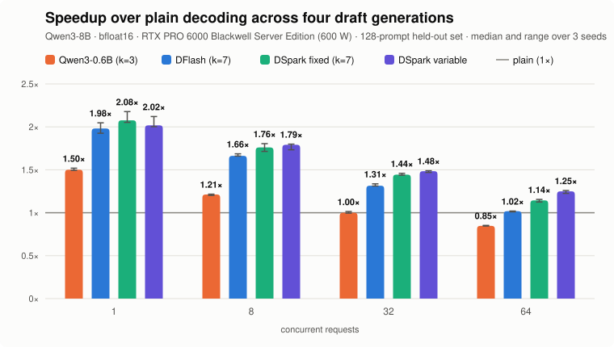
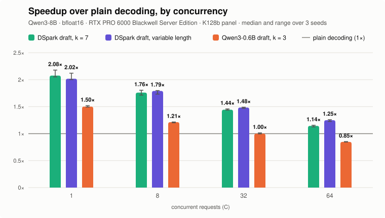

<div align="center">

# nano-vllm-speculative-decoding

基于 [nano-vLLM](https://github.com/GeeeekExplorer/nano-vllm) 的块式投机解码：从 0.6B 独立小模型演进至 DFlash 并行草稿、DSpark 块内 Markov 修正与变长验证。

**单请求 2.02× · 8 并发 1.79× · 32 并发 1.48× · 64 并发 1.25×**

[](https://github.com/tianyuantong/nano-vllm-speculative-decoding/actions/workflows/cpu-tests.yml)


[](LICENSE)

[English](README.md) | **简体中文** · [快速开始](#快速开始) · [结果](docs/RESULTS.md) · [使用指南](docs/DECODING.md)

<picture>
  <source media="(prefers-color-scheme: dark)" srcset="docs/assets/speedup-overview-dark.svg">
  
</picture>

</div>

> **当前分支 `disagg/dual-gpu-1p1d` —— 双卡 1P+1D Prefill-Decode 分离引擎。** 在 [`main`](https://github.com/tianyuantong/nano-vllm-speculative-decoding/tree/main) 基础上扩展 [`DisaggLLM`](nanovllm/disagg/disagg_engine.py) 与 [`KVCacheTransfer`](nanovllm/disagg/kv_transfer.py)：单进程双线程在 `cuda:0` 执行 prefill、`cuda:1` 执行 decode 与投机验证，通过连续环形缓冲单次 P2P DMA 跨卡交接 target 与 5 层 draft KV 块（[压测入口](tools/bench_pd.py) · [双卡冒烟校验](tools/smoke_pd.py) · [双卡实测结果 →](docs/RESULTS.md#12-dual-gpu-prefill-decode-disaggregation-1p1d)）。

基于 Qwen3-8B 与单卡 RTX PRO 6000（600 W）实测，通过拒绝采样保证输出分布与原模型一致。

| 并发请求数 | 0.6B 小模型 (k=3) | DFlash (k=7) | DSpark (k=7) | DSpark 相对 DFlash | 每轮生成 token 数 (DFlash / DSpark) |
|---:|---|---|---|---|---|
| 1 | 1.54× | 2.00× | **2.10×** | 1.07× | 2.59 / 2.82 |
| 8 | 1.21× | 1.68× | **1.78×** | 1.06× | 2.53 / 2.81 |
| 32 | 0.96× | 1.31× | **1.43×** | 1.10× | 2.70 / 2.95 |
| 64 | 0.82× | 1.01× | **1.15×** | 1.14× | 2.65 / 2.93 |

表中为 128 条留出测试集上相对普通解码的稳态吞吐倍数（3 个 seed 中位数）。其中 0.6B 独立小模型（[`baseline/qwen3-0.6b-draft`](https://github.com/tianyuantong/nano-vllm-speculative-decoding/tree/baseline/qwen3-0.6b-draft)，每轮生成 2.49–2.53 token）测于第一批 128 题测试集（同集下 DFlash 为 2.19× / 1.80× / 1.40× / 1.08×，对应左图）；其余各列均在同一批测试集（对应右图）中背靠背测得。[完整数据与评测协议 →](docs/RESULTS.md) · [0.6B 基线对照详情 →](docs/v2/RESULTS.md)

## 变长验证

在 DSpark 中，target 验证步约占单轮耗时的四分之三，且随并发升高而显著变贵：实测成本表中，每条请求验证 8 个位置相比验证 1 个位置，单轮耗时在 16、32、64 并发下分别增加 14%、25% 与 49%。开启变长验证后，引擎按 DSpark 算法 1 将批内所有候选位置按预测存活概率排序，结合实测轮时长表在预估吞吐持续上升的区间内动态截取验证长度，并将总验证位置数向上对齐至 CUDA Graph 档位，在 32 与 64 并发下将加速比进一步提升至 **1.48×**（+2.2%）与 **1.25×**（+8.9%）。

<picture>
  <source media="(prefers-color-scheme: dark)" srcset="docs/assets/speedup-variable-dark.svg">
  
</picture>

| 并发请求数 | 0.6B 小模型 (k=3) | DSpark 定长 | DSpark 变长 | 变长相对定长 | 每请求每轮验证位置数 |
|---:|---|---|---|---|---|
| 1 | 1.50× | 2.08× | 2.02× | −2.7% | 8.00 |
| 8 | 1.21× | 1.76× | 1.79× | +2.2% | 6.68 |
| 32 | 1.00× | 1.44× | **1.48×** | **+2.2%** | 4.62 |
| 64 | 0.85× | 1.14× | **1.25×** | **+8.9%** | 4.43 |

表中为第二批 128 题测试集上 3 个 seed 的中位数（Colab G4 RTX PRO 6000，600 W）；`变长相对定长` 按同 seed 配对计算中位数（32 与 64 并发下 3 个 seed 同向显著，8 并发下各 seed 涨跌互现）。[变长验证详情 →](docs/RESULTS.md#8-variable-length-verification)

- **高并发验证耗时缩减**：64 并发下单轮验证耗时从 36.51 ms 降至 27.96 ms，接受步从 4.31 ms 降至 2.45 ms；单轮总耗时缩短 18.6%，每轮仅少产出 5.6% 的 token，解码轮净吞吐提升 +16.1%（计入 prefill 停顿后整体提升 +8.9%）。
- **低并发路径开销**：单请求下每轮均验满 8 个位置，输出与定长模式逐 token 一致，2.7% 的回落来自置信度计算与动态长度调度的固定开销。

## 性能拆解与横向对比

- **块式草稿消除了串行自回归开销。** 独立 0.6B 模型每轮需串行跑 3 步 decode（耗时约 6 ms）并维护独立 KV cache，并发升至 32 时被验证成本反超（0.96×）；块式 draft 一次前向同时提出 7 个候选 token，大幅压低草稿耗时。
- **DSpark 靠 Markov head 拉高接受率。** 每轮产出 token 数比 DFlash 高 7–12%。在 C=32–64 下，仅在 top-k 候选窗口内采样还省去了全词表 softmax 开销（阶段耗时拆解显示该项约占领先幅度的 2–6 个百分点）。
- **高并发下收益收窄。** 并发升高后，target 验证步每行的计算成本上升；同时本引擎的 prefill 步会暂停 decode，在 C=32 时占了 DSpark 稳态窗口 31% 的时间。
- **轮流 prefill 缩短停顿。** 打开 `round_robin_prefill=True`（默认关）后，一步只放进一条新请求，随后解码一步。在第二批 128 题测试集上，一条请求相邻两次交付的最长间隔是 70–110 ms，默认调度下最长 1.1 s；C=32–64 时 DSpark 的 ITL p99 降到默认调度的 0.58–0.73 倍，吞吐是 0.97–1.00 倍。代价由新到的请求承担：中途到达的请求，TTFT p99 升到 1.0–3.8 倍（[结果](docs/RESULTS.md#9-round-robin-prefill)）。
- **双卡 Prefill-Decode 分离（1P+1D）。** 在单进程双线程 1P+1D 引擎（分支 [`disagg/dual-gpu-1p1d`](https://github.com/tianyuantong/nano-vllm-speculative-decoding/tree/disagg/dual-gpu-1p1d) 的 `DisaggLLM`，`cuda:0` 负责 prefill、`cuda:1` 负责 decode，经连续环形缓冲单次 P2P DMA 交接 KV，2 × RTX PRO 6000）上，C=32–64 时总稳态吞吐达单卡默认调度的 1.35–1.52 倍（单卡效率 0.68–0.76 倍），全程普通解码 ITL p99 降至 0.15–0.19 倍（13.3–23.6 ms）、DSpark ITL p99 降至 0.24–0.31 倍（31.6–81.4 ms，约为单卡轮流 prefill 0.61–0.72 倍的一半；[结果](docs/RESULTS.md#12-dual-gpu-prefill-decode-disaggregation-1p1d)）。
- **硬件 Roofline 拆解与手写 Triton 融合算子。** 对照 RTX PRO 6000 实测可达 HBM 读带宽上限（1.52 TB/s），普通解码已达 82–94% 带宽（步耗时为硬件下限的 1.12–1.22 倍）；而 8-query 验证注意力因 `flash_attn_with_kvcache` 在 `q_len > 1` 时退化关闭 4:1 GQA query 打包，有效带宽仅 39–61%，且全词表拒绝采样在 C=32–64 下耗时 2.2–4.3 ms。在 `exp/fused-kernels` 分支中，将前缀 KV 拆给 4:1 打包的 `flash_attn_varlen_func` 并由 Triton 算子融合尾部因果注意力与在线 LSE 合并，同时将稀疏候选（`top_k + 64`）Markov 采样与 1024 分块拒绝采样融合为两个 Triton 算子，在 C=32–64 下缩短满批轮耗时 10.6–13.9%（等接受率吞吐 +7.7–9.9%），在 3k 上下文下缩短 31.4%（73.5 → 50.5 ms，吞吐 +18.6%；[结果](docs/RESULTS.md#10-speed-of-light-roofline-and-hand-written-triton-kernels)）。
- **Prefix Caching 交互效应。** 在 512–2,048 共享前缀 token 下（60 组 × 5 个 seed），开启前缀缓存使所有线的稳态吞吐提升 13–70%、稳态 TTFT p50 从 70–148 ms 降至 51–59 ms，但投机解码相对普通解码的加速比在 C=32–64 下收窄 6–12%——原因是批内共享物理 KV 块驻留 L2 cache，对 1-query 普通解码注意力的提速（42–55%）远大于对 8-query 验证注意力的提速（5–23%；[结果](docs/RESULTS.md#11-prefix-caching-with-speculative-decoding)）。
- **对比 vLLM**（同一台机器，48 条开发集，5 个 seed，全流程挂钟吞吐，vLLM `372477d`）：跑 DSpark 时，C=1–32 下比 vLLM 慢 5.8–8.2%，一轮多出的时间在 draft 一侧；关闭投机时，两者相差不到 2%。

## 核心实现（四代架构演进）

当前主分支引擎共 2,850 行，沿四条线递进演进：
- **第一代：0.6B 独立小模型（分支 [`baseline/qwen3-0.6b-draft`](https://github.com/tianyuantong/nano-vllm-speculative-decoding/tree/baseline/qwen3-0.6b-draft)）**：双模型独立维护各自的块表与 KV cache，draft 串行自回归起草 k=3 步，target 通过固定长度 CUDA Graph 一次前向验证，并在 GPU 上用向量化采样器（`SpecSampler`）完成整批拒绝采样与回滚。
- **第二代：DFlash 块式并行草稿**：移除独立小模型与双份块表，复用 decode 注意力路径一次跑 7 个 query 的非因果注意力，直接读取 target 的 5 层辅助特征；5 层 draft KV cache 与 target 共用同一张块表（`block_tables`），在验证后写入已接受位置的上下文 K/V。
- **第三代：DSpark 块内 Markov 修正**：在 DFlash 块特征之上通过 Markov head 由左向右依次采样 7 个位置，并以叠加偏置后的分布参与拒绝采样验证；全程由三段 CUDA Graph 覆盖（target 验证前向、draft 块前向、DSpark 7 步块内采样）。
- **第四代：变长验证**：利用 DSpark 置信度头计算各位置的存活概率（校准后置信度的前缀积），结合实测轮时长表在整批内按估算吞吐增量决定每行验证长度，并将总验证位置数向上对齐至 CUDA Graph 档位，同时保持无损拒绝采样。

入口代码：`SpeculativeDecoder.run_round`（单轮五步流水）、`VerifySchedule.verify_lengths`、`DFlashDrafter.propose`、`_markov_rows` 与 `after_verify`，以及 `Attention.forward` 的 decode 分支。

## 正确性验证

候选 token 按标准拒绝采样验证：当 $u \lt \min(1, p_{\text{target}}(x) / p_{\text{draft}}(x))$ 时接受 $x$ ，否则从残差分布 $\text{normalize}(\max(p_{\text{target}} - p_{\text{draft}}, 0))$ 重采样，输出分布与原模型严格一致（DSpark 中 $p_{\text{draft}}$ 取每行叠加 Markov 偏置后的分布）。

GPU 实测覆盖四项检验：
- 采样器多步输出分布（29 个测试用例）
- DSpark 块输出与 Markov 修正后 logits 对比参考实现 DeepSpec（相对误差 0.59–1.08%）
- 验证步 logits 对比逐步 decode（最大绝对差 0.84）
- GSM8K 数学推理数据集准确率（84.7% 对比普通解码 85.2%，差值 −0.5 个百分点，95% 置信区间 −1.7 ~ +0.8 个百分点）

变长验证通过了采样器、验证 logits 和 GSM8K 三项检验：准确率 84.2%，普通解码 85.1%，差值 −0.87 个百分点，95% 置信区间 −2.14 ~ +0.40 个百分点。

在 DSpark 论文自己的题目和采样设置下，本引擎复现了论文 Table 1 的每轮 token 数：DFlash 4.10、DSpark 4.80，论文是 4.07、4.81（9 个数据集，3,030 道题；[详情](docs/RESULTS.md#53-tokens-per-round-against-the-dspark-paper)）。

## 踩过的坑

- **fp32 下原地改写输入**：输入已经是 fp32 时，`x.float()` 直接返回原张量引用，导致上游 RMSNorm 原地修改了输入张量。bf16 路径不受影响，该问题在 fp32 下与 DeepSpec 对齐数值时暴露。
- **`torch.compile` 重编译回退**：默认重编译上限（8 次）耗尽后，新形状会回退到未编译路径，破坏 CUDA Graph 与 eager 模式的逐位一致性；将上限调至 64 后恢复。
- **vLLM 基线对齐**：vLLM（`372477d`）默认对 draft 做 greedy 采样，且 DeepSpec 的 DFlash 权重需走其 `dspark` 路径以匹配块布局；对照测试时已将其统一改为同分布随机采样。
- **多 query 验证时 GQA 打包失效**：`flash_attn_with_kvcache` 仅在 `q_len == 1` 时将每个 KV head 对应的 4 个 query head 打包进同一个 tile；每请求一次验证 8 个候选位置时会退出打包路径，导致验证注意力仅跑出可达 HBM 读带宽的 39–61%（`§7`、`§10`）。
- **双卡 1P+1D 跨线程 CUDA 锁与 `> 2 GiB` KV 索引切分**：prefill 线程在 `cuda:0` 步末调用 `.tolist()` 会持有设备运行时锁，阻塞 `cuda:1` 跨设备拉取 KV 块；同时在 25.5 GiB（`> 2³¹` 字节）KV 池上直接 `index_select` 会触发 32 位索引回退，将每层拷贝拆成 16 个 kernel。改为由 prefill 线程先打入连续环形缓冲区再单次 P2P DMA 推送至 `cuda:1` 后解决（`§12`）。

## 快速开始

环境要求：Python 3.10–3.12，CUDA GPU（显存需容纳 target 与 draft 模型及其 KV cache）。

```bash
git clone https://github.com/tianyuantong/nano-vllm-speculative-decoding.git
cd nano-vllm-speculative-decoding
pip install torch triton flash-attn "transformers>=4.51" xxhash pytest
python -m pip install -e . --no-deps
```

填入本地模型路径即可运行：

```python
from nanovllm import LLM, SamplingParams

llm = LLM(
    "/models/Qwen3-8B",
    draft_model="/models/dspark_qwen3_8b_block7",    # deepseek-ai/dspark_qwen3_8b_block7
    draft_type="dspark",
    max_num_seqs=8,
    enable_prefix_cache=False,
    kv_cache_memory_bytes=10 << 30,
    seed=0,
)
params = SamplingParams(temperature=0.7, top_k=20, top_p=0.8, max_tokens=256)

try:
    outputs = llm.generate(["Explain KV caching."], params)
    print(outputs[0]["text"])
finally:
    llm.exit()
```

DSpark 与 DFlash 每轮固定提出 7 个候选 token（由权重块大小决定），无需设置 `num_speculative_tokens`。`kv_cache_memory_bytes` 按 target 层数分配块预算，5 层 draft KV 共用同一张块表、在预算外独立分配。切换 DFlash 时传入 `draft_model="/models/dflash_qwen3_8b_block7"` 与 `draft_type="dflash"`；普通解码省略 `draft_model` 即可。0.6B 独立小模型版的代码、架构说明与用法位于分支 [`baseline/qwen3-0.6b-draft`](https://github.com/tianyuantong/nano-vllm-speculative-decoding/tree/baseline/qwen3-0.6b-draft)。
[模型配置与 API →](docs/DECODING.md)

## 复现

先构建测试面板，再在同一目录下跑完普通解码（`k0`）与投机解码的各并发及 seed：

```bash
python -m pytest -q    # CPU 测试，30 秒内
python tools/fetch_panels.py && python tools/build_panel_k128.py
for c in 1 8 32 64; do
  for s in 17011 110017 130031; do
    for line in k0 dflash_k7 dspark_k7; do
      python bench_spec.py --mode closed-loop --protocol benchmarks/protocol-v2.1.json --panel K128b \
          --line "$line" --concurrency "$c" --seed "$s" --models-root /path/to/models \
          --commit "$(git rev-parse --short HEAD)" --output "runs/${line}_c${c}_s${s}.json"
    done
  done
done
python tools/report_v2.py --protocol benchmarks/protocol-v2.1.json --results runs
```

变长验证改用 `benchmarks/protocol-v2.3.json`，评测线为 `k0 dspark_k7 dspark_var`（线名、并发与 seed 均定义在该协议文件中）。`tools/report_v2.py` 汇总吞吐与加速比，`tools/gain_factors.py` 拆解各因素贡献，`tools/plot_speedup.py` 生成加速比柱状图。各表对应的原始结果 JSON 与测试面板打包在两个 release 附件中：[`results-dflash-dspark`](https://github.com/tianyuantong/nano-vllm-speculative-decoding/releases/tag/results-dflash-dspark) 与存放变长验证数据的 [`results-variable-length`](https://github.com/tianyuantong/nano-vllm-speculative-decoding/releases/tag/results-variable-length)。

## 深入了解

| 文档 | 内容 |
|---|---|
| [结果](docs/RESULTS.md) | DSpark 对比 DFlash、变长验证、轮流 prefill、双卡 1P+1D、前缀缓存、Roofline 与 Triton 算子、与 vLLM 对比及正确性检验 |
| [DFlash 结果](docs/v2/RESULTS.md) | DFlash 对比 0.6B 独立小模型、单轮阶段耗时与 prefill 停顿 |
| [使用指南](docs/DECODING.md) | 模型配置、采样参数与计时 API |
| [工具](tools/README.md) | 测量、校验与分析脚本清单 |
| [0.6B 分支与架构设计](docs/design/batched-speculative-decoding.md) | 0.6B draft 版本：双模型执行、KV 状态、批处理与 CUDA Graph |
| [0.6B 初版结果](docs/v1/RESULTS.md) | 0.6B draft 版本：不同 batch size 的性能、阶段耗时与重复性 |
| [优化历程](docs/PERFORMANCE.md) | 第一版性能剖析，以及推动本次重写的主要瓶颈 |

CPU 测试通过 [GitHub Actions](.github/workflows/cpu-tests.yml) 运行。

## 致谢

基于 [GeeeekExplorer/nano-vllm](https://github.com/GeeeekExplorer/nano-vllm) 构建。DFlash 块式草稿设计源自 [DFlash](https://github.com/z-lab/dflash)（[arXiv:2602.06036](https://arxiv.org/abs/2602.06036)），DSpark 源自 DeepSeek（[arXiv:2607.05147](https://arxiv.org/abs/2607.05147)）；两份 draft 权重及对齐所用的参考实现均来自 [DeepSpec](https://github.com/deepseek-ai/DeepSpec)。基座模型使用 [Qwen3](https://huggingface.co/Qwen/Qwen3-8B)，底层算子基于 [FlashAttention](https://github.com/Dao-AILab/flash-attention) 与 [Triton](https://github.com/triton-lang/triton)。采样算法参考 Leviathan 等人的 *Fast Inference from Transformers via Speculative Decoding*（2023）与 Chen 等人的 *Accelerating Large Language Model Decoding with Speculative Sampling*（2023）。
[上游版本与项目历史 →](docs/UPSTREAM.md)

## 许可

[MIT](LICENSE)。
