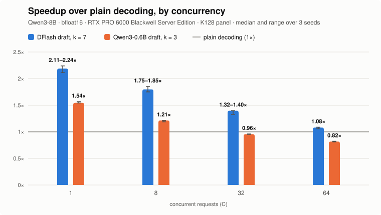

<div align="center">

# nano-vllm-speculative-decoding

为 [nano-vLLM](https://github.com/GeeeekExplorer/nano-vllm) 实现投机解码：独立 draft 模型，以及 DFlash 块式 draft。

**C=1 吞吐 2.11–2.24 倍 · C=8 为 1.75–1.85 倍 · C=32 为 1.32–1.40 倍**

[](https://github.com/tianyuantong/nano-vllm-speculative-decoding/actions/workflows/cpu-tests.yml)


[](LICENSE)

[English](README.md) | **简体中文** · [快速开始](#快速开始) · [结果](docs/RESULTS.md) · [实现设计](docs/design/batched-speculative-decoding.md)

<picture>
  <source media="(prefers-color-scheme: dark)" srcset="docs/assets/speedup-k128-dark.svg">
  
</picture>

</div>

Qwen3-8B 接 DFlash draft，RTX PRO 6000。输出分布不变（已检验）；GSM8K 准确率与不投机相差 −1.5 … +0.9 个百分点。

怎么测的：同一引擎内对不投机的稳态吞吐，未看过的 128 条确认集，每档 3 个 seed，写中位数（最小–最大）；C=64 为 1.08 倍（1.06–1.09），在计时噪声内。原来的 0.6B draft 为 1.54 / 1.21 / 0.96 / 0.82 倍。和 vLLM 比（同卡同权重，开发版 `372477d`，开发集，挂钟吞吐）：C=1 为 155 对 156 tok/s，C=8 到 32 慢 7–9%。[测量协议、闸门和负结果 →](docs/RESULTS.md)

| C | 0.6B draft（k=3） | DFlash（k=7） | DFlash ÷ 0.6B | 每轮 token 数（0.6B / DFlash） |
|---:|---|---|---|---|
| 1 | 1.54 倍（1.54–1.57） | 2.11–2.24 倍 | 1.37–1.45 | 2.52 / 2.85 |
| 8 | 1.21 倍（1.19–1.21） | 1.75–1.85 倍 | 1.44–1.56 | 2.49 / 2.75 |
| 32 | 0.96 倍（0.95–0.96） | 1.32–1.40 倍 | 1.38–1.48 | 2.53 / 2.82 |
| 64 | 0.82 倍（0.81–0.82） | 1.08 倍（1.06–1.09） | 1.29–1.33 | 2.53 / 2.82 |

并发越高收益越小：verify 每行的成本过了约 128–256 行就变陡，而这个引擎的 prefill 步会让 decode 停下，C=32 时占稳态时间的 29%。C≤32 用 DFlash；C=64 时它并不比不投机快。

## 新增了什么

在 0.6B draft 版本之上，12 个引擎文件新增 434 行、删 107 行（引擎现共 2627 行）：
- DFlash 的 draft 块（最后一个已提交 token 加 6 个占位 token）走 decode 路径，一次 7 个 query、非因果的注意力。
- target 在 prefill 和 verify 时导出 5 层的 hidden state（hidden + residual）。
- verify 之后把 8 个位置的上下文 K/V 全部写入；被拒的位置在被读到之前一定会被下一块覆盖。
- draft 和 target 共用块表和 pad 块，不需要第二套 KV 分配。
- 两张 CUDA graph：verify（同时导出那 5 层）和 draft 块前向。

关键代码：`SpeculativeDecoder.run_round`（一轮五步）、`DFlashDrafter.propose` 和 `after_verify`、`Attention.forward` 的 decode 分支。

## 正确性

接受规则是标准的投机采样：u < min(1, p_target(x) / p_draft(x)) 时保留 draft x，否则从 normalize(max(p_target − p_draft, 0)) 重新采样，所以输出分布就是 target 的分布。在 GPU 上检验过：采样器的多步输出分布（29 例）、verify 对逐步 decode 的 logits（最大差 0.75 / 0.84，门槛 3.0）、GSM8K 准确率（与不投机相差 −1.5 … +0.9 个百分点）。

## 这不是什么

- 不是在线服务系统：数字来自离线闭环测量。
- 不是新的 draft 方法：draft 用的是 [DFlash](https://github.com/z-lab/dflash) 的设计，权重是 DeepSpec 的 `dflash_qwen3_8b_block7`。
- 不是大规模部署：一张卡、一个 8B 稠密模型。

## 快速开始

使用 Python 3.10–3.12 和 CUDA GPU，显存需容纳两个模型及其 KV cache。

```bash
git clone https://github.com/tianyuantong/nano-vllm-speculative-decoding.git
cd nano-vllm-speculative-decoding
pip install torch triton flash-attn "transformers>=4.51" xxhash
python -m pip install -e . --no-deps
```

填入本地模型路径即可生成：

```python
from nanovllm import LLM, SamplingParams

llm = LLM(
    "/models/Qwen3-8B",
    draft_model="/models/dflash_qwen3_8b_block7",    # deepseek-ai/dflash_qwen3_8b_block7
    draft_type="dflash",
    max_num_seqs=8,
    enable_prefix_cache=False,
    kv_cache_memory_bytes=10 << 30,
    seed=0,
)
params = SamplingParams(temperature=0.7, top_k=20, top_p=0.8, max_tokens=256)

try:
    outputs = llm.generate(["Explain KV caching."], params)
    print(outputs[0]["text"])
finally:
    llm.exit()
```

DFlash draft 每轮提出块大小（7）个 token，上下文 K/V 存在 target 的块里，所以不用设 `num_speculative_tokens`，也不用 draft 的 KV 预算。用 0.6B draft 时传 `draft_model="/models/Qwen3-0.6B"`、`num_speculative_tokens=3` 和 `draft_kv_cache_memory_bytes`；普通解码省略 `draft_model` 即可。
[模型配置与 API →](docs/DECODING.md)

## 复现

```bash
python -m pytest -q    # CPU 测试：198 个通过，约 6 秒
python bench_spec.py --mode closed-loop --protocol benchmarks/protocol-v2.json --panel K128 --line dflash_k7 \
    --concurrency 8 --seed 17011 --commit <sha> --output result.json
```

面板由 `tools/fetch_panels.py`（D48）和 `tools/build_panel_k128.py`（K128）生成；`tools/report_v2.py` 按 protocol 的判据出结论，`tools/plot_speedup.py` 画上面那张图。

## 深入了解

| 文档 | 内容 |
|---|---|
| [结果](docs/RESULTS.md) | 两个面板、和 vLLM 的对比、闸门、一轮的时间花在哪 |
| [实现设计](docs/design/batched-speculative-decoding.md) | 双模型执行、KV 状态、批处理与 CUDA Graph |
| [使用指南](docs/DECODING.md) | 模型配置、采样参数与计时 API |
| [工具](tools/README.md) | 测量、闸门和分析脚本，每个一行说明 |
| [9 月结果](docs/v1/RESULTS.md) | 0.6B draft 版本：不同 batch size 的性能、阶段耗时、重复性 |
| [优化历程](docs/PERFORMANCE.md) | 第一版的性能分析，以及推动本次重写的主要瓶颈 |

CPU 测试通过 [GitHub Actions](.github/workflows/cpu-tests.yml) 运行。

## 致谢

基于 [GeeeekExplorer/nano-vllm](https://github.com/GeeeekExplorer/nano-vllm)。这个仓库加的部分：用独立 draft 模型的批量投机解码（0.6B 那条线，9 月发布）；以及 DFlash 的这几样：draft 块的 7-query 非因果 decode 模式；target 导出 5 层的 hidden + residual；verify 后给所有被验证的位置写上下文 K/V，靠下一块覆盖被拒的位置；draft 和 target 共用块表；两张 CUDA graph（verify 和 draft 块前向）。

DFlash 的 draft 设计来自 [DFlash](https://github.com/z-lab/dflash)（[arXiv:2602.06036](https://arxiv.org/abs/2602.06036)）；权重，以及移植时逐项比对的参考实现，来自 [DeepSpec](https://github.com/deepseek-ai/DeepSpec)。模型用 [Qwen3](https://huggingface.co/Qwen/Qwen3-8B)，kernel 用 [FlashAttention](https://github.com/Dao-AILab/flash-attention) 与 [Triton](https://github.com/triton-lang/triton)。采样算法参考 Leviathan 等人的 *Fast Inference from Transformers via Speculative Decoding*（2023）和 Chen 等人的 *Accelerating Large Language Model Decoding with Speculative Sampling*（2023）。
[上游版本与项目历史 →](docs/UPSTREAM.md)

## 许可

[MIT](LICENSE)。
