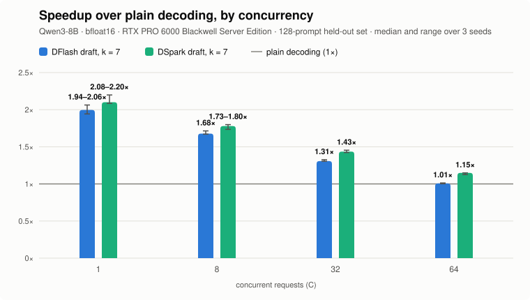
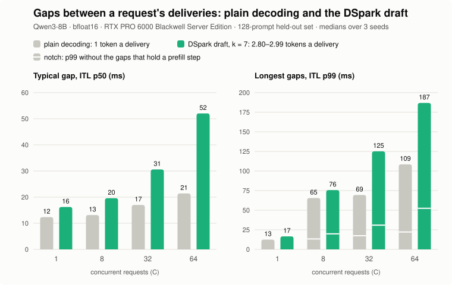
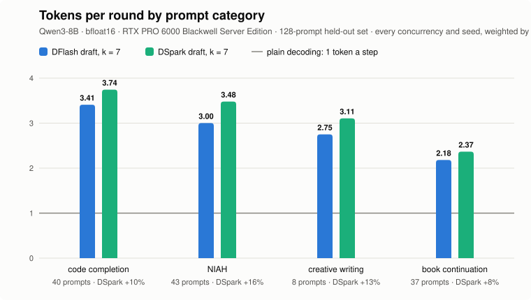
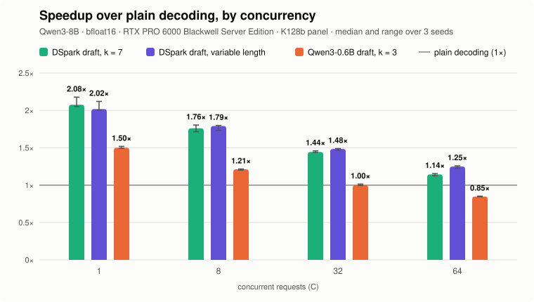

# Results: DSpark speculative decoding on nano-vLLM

On an RTX PRO 6000 with Qwen3-8B in BF16, the DSpark draft (DeepSpec's `dspark_qwen3_8b_block7`) proposes 7 tokens per round like DFlash, then corrects them left to right with its Markov head; a round yields 2.81–2.95 tokens on average. On the unseen K128b confirmation panel, its steady-state throughput is **2.08–2.20×** plain decoding at C = 1, **1.73–1.80×** at C = 8, **1.43× (1.42–1.45)** at C = 32 and **1.15× (1.13–1.15)** at C = 64, faster at all four.

DFlash in the same engine and jobs gives 1.94–2.06 / 1.68 / 1.31 / 1.01×, and DSpark is faster than it at every concurrency: by 4.4–8.1% at C = 1, 1.2–7.7% at C = 8, 8.9–9.9% at C = 32 and 11.0–14.7% at C = 64. At C = 32 and 64, an estimated 2–6 points of that lead come from the two lines sampling differently (§3). Against vLLM's DSpark (same machine, same weights, development panel, wall-clock throughput of the whole run), nano is 5.8–8.2% behind at C = 1, 8 and 32.

**Measurement definitions**
- **Concurrency C**: number of active requests in flight; a new request enters the batch as soon as one finishes.
- **Steady-state throughput `Q_steady` and speedup `R`**: `Q_steady` is output tok/s over the window where all `C` requests are active; `R` divides a line's `Q_steady` by plain decoding (`k0`) at the same `C` and seed within the same job (`N_t` denotes repeat-pair timing noise). The vLLM comparison uses end-to-end wall-clock throughput (§4).
- **Prompt panels (`D48`, `K128`, `K128b`)**: stratified subsets of NVIDIA [SPEED-Bench](https://huggingface.co/datasets/nvidia/SPEED-Bench) `throughput_1k` (~1,000-token prompts across four categories): `D48` is the 48-prompt development set (5 seeds per `C`), and `K128` / `K128b` are two disjoint 128-prompt held-out confirmation sets (run once with 3 seeds per `C`).
- **Protocol**: all decision thresholds and invalidation rules are fixed in [`benchmarks/protocol-v2.1.json`](../benchmarks/protocol-v2.1.json), frozen prior to the GPU runs.

## 1. Confirmation panel (K128b)

K128b uses the same category quotas as K128—needle-in-a-haystack retrieval (NIAH, 43), code completion (40), classic book continuation (`open_books`, 37), and creative writing (8)—drawn from NVIDIA SPEED-Bench `throughput_1k` with a new salt; prompts used in D48 or K128 are excluded by question id and by prompt text. Categories are interleaved in proportion to their quotas, so creative writing is 6% of the first 48 prompts (used at C = 1 and 8), as in the whole panel; in K128 it was 17%.

  <picture>
    <source media="(prefers-color-scheme: dark)" srcset="assets/speedup-k128b-dark.svg">
    
  </picture>

| C | DFlash (k = 7) | DSpark (k = 7) | DSpark over DFlash, per seed |
|---:|---|---|---|
| 1 | **1.94–2.06** | **2.08–2.20** | +4.4 … +8.1% |
| 8 | **1.68 (1.67–1.71)** | **1.73–1.80** | +1.2 … +7.7% |
| 32 | **1.31 (1.31–1.33)** | **1.43 (1.42–1.45)** | +8.9 … +9.9% |
| 64 | 1.01 (1.00–1.01) | **1.15 (1.13–1.15)** | +11.0 … +14.7% |

Values are the median (min–max) over seeds, to two decimals, or only the range when it spans more than 0.05. **Bold** marks a line that is faster than plain decoding by the protocol's rule.

- **Speedup threshold**: A line is marked faster when every seed's speedup `R` exceeds `1 + 2 × N_t`, where the timing noise `N_t = 1.38%` is measured from 9 repeat pairs on the development matrix on the same machine and engine.
- **DSpark vs DFlash**: At every concurrency, all per-seed paired gains have the same sign and their median exceeds `2 × N_t`.
- **Tokens per round** (round-weighted mean): DSpark `2.81–2.95`, DFlash `2.53–2.70`.

### Latency

<picture>
  <source media="(prefers-color-scheme: dark)" srcset="assets/k128b-gaps-dark.svg">
  
</picture>

| C | line | TTFT p50 / p99 | ITL p50 / p99 | ITL p99 without prefill gaps | gaps with a prefill step | round p50 / p99 |
|---:|---|---|---|---:|---:|---|
| 1 | plain decoding | 52 / 61 | 12.3 / 12.5 | 12.5 | 0% | 12.3 / 12.5 |
| 1 | DSpark | 54 / 63 | 16.2 / 16.6 | 16.6 | 0% | 16.2 / 16.6 |
| 8 | plain decoding | 53 / 341 | 13.1 / 65.5 | 13.3 | 2% | 13.1 / 13.3 |
| 8 | DSpark | 55 / 349 | 19.6 / 75.7 | 19.9 | 5% | 19.6 / 19.8 |
| 32 | plain decoding | 52 / 1369 | 17.0 / 69.4 | 17.4 | 7% | 16.9 / 17.4 |
| 32 | DSpark | 54 / 1395 | 30.6 / 125.1 | 30.9 | 22% | 30.4 / 30.8 |
| 64 | plain decoding | 54 / 2748 | 21.4 / 108.5 | 22.2 | 13% | 21.2 / 22.0 |
| 64 | DSpark | 90 / 2797 | 52.0 / 186.8 | 52.4 | 39% | 51.7 / 52.3 |

Milliseconds, medians over the 3 seeds, from [`tools/request_stats.py`](../tools/request_stats.py).

- **ITL** is the gap between two consecutive deliveries to one request, so it shows how tokens arrive, not how fast: in the steady window a DSpark delivery carries 2.80–2.99 tokens, plain decoding's one. On average a request still gets its tokens R times as fast, since in a closed loop its rate is Q_steady ÷ C: from 2.08–2.20× at C = 1 down to 1.15× at C = 64.
- **The longest gaps hold a prefill step.** At C = 8–64, DSpark's ITL p99 is 1.2–1.8 times plain decoding's. Without the gaps that hold a prefill step (the notches), the p99 is about one round. Prefill steps do no decoding in this engine ([DFlash results](v2/RESULTS.md) §5.2), and DSpark, finishing requests sooner, takes in new ones more often: 22% of its gaps hold a prefill step at C = 32, against 7% for plain decoding.
- **TTFT** is the same with and without speculation up to C = 32. A request prefilled alone gets its first token after about 52 ms, one that shares its prefill step with another after about 90. At C = 64, 39–40% of DSpark's requests that arrive after the start share it, against 29–32% for plain decoding, and that moves DSpark's median into the second group. The p99 comes from the start of each run, when all C requests arrive at once, and is the same for both.
- DFlash's TTFT and gaps are within 6% of DSpark's.

## 2. Development panel (D48) and confirmation panel (K128b)

| C | DFlash, D48 | DFlash, K128b | DSpark, D48 | DSpark, K128b |
|---:|---|---|---|---|
| 1 | 1.91–1.99 | 1.94–2.06 | 2.00 (1.98–2.03) | 2.08–2.20 |
| 8 | 1.69 (1.66–1.71) | 1.68 (1.67–1.71) | 1.72–1.82 | 1.73–1.80 |
| 32 | 1.26 (1.26–1.30) | 1.31 (1.31–1.33) | 1.40 (1.38–1.40) | 1.43 (1.42–1.45) |
| 64 | 1.01 (0.99–1.03) | 1.01 (1.00–1.01) | 1.12 (1.11–1.13) | 1.15 (1.13–1.15) |
| tokens per round | 2.47–2.55 | 2.53–2.70 | 2.70–2.79 | 2.81–2.95 |

D48 has 5 seeds per C and also covers C = 2, 4 and 16: DSpark 1.99–2.06, 1.78–1.88 and 1.56–1.65; DFlash 1.91–1.96, 1.71–1.84 and 1.54 (1.54–1.58). DSpark is faster than DFlash at all seven. The two panels agree on the direction and on every verdict.

- **Before candidate sampling.** A first matrix, on the engine before candidate-only sampling (`ed4a35c`), could not call DSpark faster than DFlash at C = 2–16. Profiling traced it to softmax and top-k over the whole vocabulary, row by row. Drawing each row among its top 84 logits instead (top-k 20 plus a margin of 64, under the same truncation rule) made DSpark faster at all seven.

## 3. Where DSpark's lead comes from

DSpark's paired gain over DFlash, split per seed into four factors that multiply to it: tokens per round, round time (DFlash's round ÷ DSpark's), the share of the steady window outside prefill steps, and the rest. A positive percentage favours DSpark; the last column is propose time, DSpark minus DFlash. Medians over seeds, 5 on D48 and 3 on K128b, from [`tools/gain_factors.py`](../tools/gain_factors.py).

| panel | C | gain | tokens per round | round | outside prefill | rest | propose difference (ms) |
|---|---:|---:|---:|---:|---:|---:|---:|
| D48 | 1 | +3.4% | +6.8% | −3.7% | −0.1% | −0.2% | +0.68 |
| D48 | 2 | +4.2% | +8.5% | −3.7% | −0.3% | −0.1% | +0.65 |
| D48 | 4 | +4.5% | +9.0% | −3.9% | −0.3% | −0.1% | +0.72 |
| D48 | 8 | +4.6% | +9.6% | −4.2% | −0.4% | −0.5% | +0.79 |
| D48 | 16 | +4.0% | +9.1% | −2.8% | −2.1% | −0.5% | +0.58 |
| D48 | 32 | +9.2% | +9.4% | +2.1% | −2.7% | +0.6% | −0.97 |
| D48 | 64 | +11.4% | +8.1% | +5.7% | −3.6% | +0.4% | −2.84 |
| K128b | 1 | +6.6% | +10.3% | −2.8% | −0.1% | −0.3% | +0.64 |
| K128b | 8 | +6.1% | +11.7% | −4.3% | −1.5% | −0.4% | +0.81 |
| K128b | 32 | +9.7% | +9.5% | +3.1% | −3.5% | +0.1% | −0.97 |
| K128b | 64 | +14.1% | +10.2% | +5.9% | −4.0% | +0.1% | −3.01 |

- **Acceptance gain (+7–12% tokens per round)**: Conditioning each draft position on the token sampled at the previous position via the Markov head raises acceptance across all concurrencies.
- **Round duration**: Up to `C = 16`, DSpark's round is 3–4% longer than DFlash's; at `C = 32` and `C = 64` it is 2–6% shorter. Nearly all of the difference lies in `propose` (`verify` differs by under 0.5 ms). The negative `outside prefill` column reflects that DSpark finishes requests faster and admits new requests more frequently, so prefill stalls ([DFlash results](v2/RESULTS.md) §5.2) occupy a larger fraction of its steady-state window (31% at `C = 32`).
- **Top-k candidate sampling at high concurrency**: Candidate-only sampling (`top_k + 64`) is enabled on the DSpark path, whereas DFlash runs softmax and top-k over the full vocabulary. As concurrency grows from `C = 16` to `C = 64`, DFlash's `propose` time increases by 7.9 ms while DSpark's increases by 4.4 ms.
- **Estimated contribution of candidate sampling**:
  - At `C = 32` and `C = 64`, DSpark's `propose` does all the work of DFlash plus sequential Markov correction, so its shorter round on D48 (2.1 and 5.7 percentage points, where `verify` differs by at most 0.18 ms) is attributable to candidate sampling; without that difference, DSpark's net lead on D48 would be roughly +7% and +5% (on K128b, `verify` is also 0.29 and 0.42 ms shorter, accounting for part of the 3.1 and 5.9 points).
  - At `C = 1` and `C = 16`, DFlash spends only 0.23 ms and 0.60 ms in logits sampling outside `lm_head`, bounding any candidate-sampling savings to at most 1.5 and 2.8 percentage points.

### By prompt category

<picture>
  <source media="(prefers-color-scheme: dark)" srcset="assets/k128b-categories-dark.svg">
  
</picture>

Tokens per round over every C and seed of K128b, weighted by rounds as in §1, from [`tools/request_stats.py`](../tools/request_stats.py).

- **DSpark's extra tokens come from every category**: +8% on book continuation up to +16% on NIAH. D48 gives +7% to +14%, in the same order.
- **The kind of text matters more than the draft.** With either draft, code completion yields about 1.6 times the tokens per round of book continuation.
- **Per request**, DSpark's tokens per round have a p10 of 2.39–2.46 and a p90 of 4.00–4.15 at the four concurrencies, DFlash's 2.12–2.24 and 3.65–3.81. Per-request values run higher than the round-weighted ones, because requests with low acceptance take more rounds.

## 4. Against vLLM (D48, wall-clock tok/s)

| C | Line | nano | vLLM | Ratio of medians | Ratio per seed | Tokens per round: nano / vLLM |
|---:|---|---|---|---:|---|---|
| 1 | plain decoding | 81.5 (81.5–81.5) | 80.0 (79.9–80.0) | 1.019 | 1.018–1.019 | – |
| 8 | plain decoding | 528.1 (514.3–542.5) | 527.8 (511.1–540.2) | 1.001 | 0.952–1.040 | – |
| 32 | plain decoding | 1301.6 (1294.3–1310.3) | 1307.6 (1288.4–1316.0) | 0.995 | 0.989–1.016 | – |
| 1 | DFlash | 155.8 (154.6–160.9) | 157.0 (155.8–159.7) | 0.992 | 0.968–1.019 | 2.50 / 2.45 |
| 8 | DFlash | 812.6 (798.5–853.1) | 859.9 (837.6–896.2) | 0.945 | 0.898–1.019 | 2.55 / 2.46 |
| 32 | DFlash | 1593.6 (1581.6–1665.1) | 1714.5 (1693.9–1760.7) | 0.930 | 0.908–0.946 | 2.52 / 2.45 |
| 1 | DSpark | 161.6 (159.4–163.9) | 172.3 (166.9–176.2) | 0.938 | 0.915–0.968 | 2.71 / 2.74 |
| 8 | DSpark | 858.7 (826.9–901.8) | 935.2 (909.5–979.4) | 0.918 | 0.877–0.956 | 2.78 / 2.81 |
| 32 | DSpark | 1673.6 (1663.8–1773.0) | 1775.9 (1741.3–1829.1) | 0.942 | 0.927–0.998 | 2.79 / 2.73 |

Both engines ran on one Colab G4 machine, 5 seeds, the two runs of a (line, C, seed) back to back. Throughputs are `median (min–max)` of the whole run's wall-clock tok/s. vLLM is `0.1.1.dev52+g372477d2d` on its v2 model runner, in its own environment (torch 2.13.0); at C = 1 it runs with `max_num_batched_tokens` 4096, at 8 and 32 with 16384 as nano does.

- **DSpark is 5.8–8.2% behind vLLM's, DFlash 0.8–7.0% behind, and plain decoding is within 2%.** Every seed has nano's DSpark behind at all three concurrencies, and its DFlash behind at C = 32.
- **Tokens per round are close**, so the gap is in the time a round takes.

**A round is longer on the draft side.** Both engines were marked with CUDA events at the same phase boundaries; the table gives a full-batch round, nano / vLLM, in ms:

| Phase | DSpark, C = 1 | DSpark, C = 8 | DFlash, C = 32 |
|---|---|---|---|
| draft: forward, draw, context store | 3.75 / 2.99 | 4.35 / 3.39 | 6.81 / 4.62 |
| target's forward | 11.30 / 11.32 | 13.70 / 13.90 | 21.42 / 21.90 |
| logits and acceptance | 1.18 / 1.07 | 1.35 / 1.18 | 3.20 / 1.92 |
| the rest | 0.11 / 0.05 | 0.13 / 0.06 | 0.20 / 0.06 |
| the round | 16.34 / 15.42 | 19.53 / 18.52 | 31.63 / 28.50 |

Of the 0.92 ms and 1.01 ms that DSpark's round is longer at C = 1 and 8, the draft's phase is 0.76 ms and 0.97 ms; the target's forward is no slower. vLLM captures the draft's backbone and its 7 sampling steps in one CUDA graph; nano uses two. With DFlash at C = 32, logits and acceptance add another 1.28 ms.

- **Two single-factor reruns did not close the gap.** Running nano on torch 2.13 with vLLM's flash attention, or sampling nano's draft with temperature only as vLLM does, leaves the per-seed ratio to vLLM at 0.92–0.96 (medians), inside the seeds' spread. Why the draft's phase is longer is not established.
- **The prefill stall.** nano's prefill steps do no decoding ([DFlash results](v2/RESULTS.md) §5.2), which costs throughput at C = 8 and 32.

nano ran from development trees that are not published (`dee9fbd`, and `8cf8e6c` at C = 1; the marked rounds from `743c261` and `c944546`). Their outputs are token-identical to this engine's where checked: 14 runs against release `results-variable-length` and the cluster reproduction, and the 30 marked runs against the unmarked ones. Raw run files, the reports and the job scripts are archived in release [`results-vllm-samehost`](https://github.com/tianyuantong/nano-vllm-speculative-decoding/releases/tag/results-vllm-samehost).

## 5. Correctness

### 5.1 Output quality (GSM8K)

| line | accuracy | difference from plain decoding, points (95% interval) |
|---|---:|---|
| plain decoding | 85.2% | — |
| DSpark | 84.7% | −0.5 (−1.7 … +0.8) |

All 1319 questions × 2 seeds, paired by question and seed. The gate requires the interval's lower end to be above −3 points; DSpark passes. Fewer than 0.2% of answers could not be parsed.

### 5.2 Gates

| gate | what it checks | result |
|---|---|---|
| G1-draft | DSpark's block logits and Markov-corrected logits against DeepSpec's reference, 8 fixtures, fed DeepSpec's greedy chain row by row | relative error 0.59–1.08% (block) and 0.60–0.92% (corrected), bound 2%; argmax equal at every decided position |
| Alignment | tokens per round, nano against DeepSpec, C = 1, temperature only, 3 seeds per side | gap 0.074 at T 0.7 (bound 0.179), 0.027 at T 1.0 (bound 0.329) |
| G1-wide | verification logits against step-by-step decoding | worst gap 0.84, bound 3.0 |
| CUDA graph vs eager | the sampling graph | bit-identical; candidate q differs from the whole-vocabulary rule by at most 6e-8, and none of the gate's 49 rows has kept tokens past the candidate window |
| Sampling graph timing | propose with the 7 sampling steps captured, against eager | C = 1: 4.07 → 3.56–3.65 ms; C = 8: 4.41 → 4.09–4.10 ms |
| G2-multi | the production sampler's multistep output distribution, on the GPU | 29 cases pass |
| G2-real | acceptance rate and output distribution on a real distribution | acceptance error 0.003 (bound 0.02), worst frequency gap 0.0023 (bound 0.0064) |

- **Decided position**: one where the reference's top logit leads the second by more than 0.5.
- G1-draft and G1-wide ran on the engine before candidate sampling (`ed4a35c`); candidate sampling changed neither the model nor verification. Alignment was rerun after it and gave the same numbers: temperature-only sampling does not take the candidate path, and its random stream did not change.

### 5.3 Tokens per round against the DSpark paper

With the prompts and sampling of the paper's evaluation code ([DeepSpec](https://github.com/deepseek-ai/DeepSpec) `005e03b`: temperature 1.0 without truncation, at most 2048 new tokens), the engine reproduces the Qwen3-8B row of Table 1 of the DSpark paper ([arXiv:2607.05147](https://arxiv.org/abs/2607.05147)). Tokens per round, the target's own token included, nano / paper:

| Set | Prompts | DFlash | DSpark | DSpark over DFlash |
|---|---:|---|---|---|
| GSM8K | 500 | 5.40 / 5.33 | 6.15 / 6.17 | +13.8% / +15.8% |
| MATH500 | 500 | 4.89 / 4.91 | 5.76 / 5.78 | +18.0% / +17.7% |
| AIME25 | 30 | 4.15 / 4.07 | 4.98 / 5.01 | +20.0% / +23.1% |
| HumanEval | 164 | 4.63 / 4.64 | 5.50 / 5.52 | +18.6% / +19.0% |
| MBPP | 256 | 4.36 / 4.36 | 5.18 / 5.16 | +18.7% / +18.3% |
| LiveCodeBench | 500 | 4.51 / 4.39 | 5.12 / 5.17 | +13.4% / +17.8% |
| MT-Bench | 80 | 3.11 / 3.11 | 3.69 / 3.72 | +18.6% / +19.6% |
| Alpaca | 500 | 3.00 / 2.98 | 3.57 / 3.58 | +18.9% / +20.1% |
| Arena-Hard | 500 | 2.80 / 2.81 | 3.24 / 3.21 | +15.8% / +14.2% |
| **Mean of the nine** | 3030 | **4.10 / 4.07** | **4.80 / 4.81** | **+17.2% / +18.4%** |

- Every set is within 3% of the paper's value, and both lines keep the paper's order of domains: math, then code, then chat.
- The paper prints the nine values and the 18.4%; its two means here are computed from the nine.
- One run per line, at 32 concurrent requests, seed 980406. DeepSpec's code runs one prompt at a time, and nano ends a request at `<|im_end|>` only; the effect of neither difference was measured.
- K128b's rounds yield 2.81–2.95 tokens under its own prompts and sampling (temperature 0.7, top-k 20, top-p 0.8). Under the paper's, the port yields what the paper reports.
- These runs give token counts only: both runs' timings are void under the protocol's rule (2 rounds each above 3 times the median), and plain decoding was not run on these prompts.

Engine `bafe536` (the run files name `ad87956`, see the appendix), on the cluster's RTX PRO 6000 Server Edition. The two runs and the script that prints the table are in release [`results-paper-table1`](https://github.com/tianyuantong/nano-vllm-speculative-decoding/releases/tag/results-paper-table1).

## 6. Estimates made beforehand

| item | estimate | measured |
|---|---|---|
| DSpark against DFlash | +4–11%, from vLLM | medians +3.4–11.4% (D48), +6.1–14.1% (K128b) |
| DSpark's extra tokens per round | about +12–18%, from vLLM | +7–10% (D48), +10–12% (K128b) |
| sampling steps left out of the graph | a round about 6% slower at C = 1 | 3.7% slower (17.04 against 16.43 ms) |
| candidate sampling | saves 0.5 ms (C = 1) to 0.7 ms (C = 16) a round; DSpark over DFlash up to +7% at C = 1 and +4–6% at C = 8–16, C = 8 likely still undecided | the sampling step's GPU time falls by 0.54 ms (C = 1) and 0.94 ms (C = 16); DSpark over DFlash +3.4% at C = 1, +4.6% at C = 8 and +4.0% at C = 16 (D48), and C = 8 is decided |

The extra tokens per round were estimated too high: nano's DFlash already gets more tokens per round than vLLM's, which leaves DSpark less to add (§4).

## 7. Open questions

- **DSpark's tokens per round moved after candidate sampling.** Candidate sampling changes how the random numbers are drawn, so the same seed produces different text. Across 35 (C, seed) pairs on D48, 23 went down and 12 up, a mean of 2.785 → 2.752 (−1.2%); DFlash, unchanged, reproduces all 35 exactly. At C = 64 all five seeds went down, by 0.03–0.06, while four of five went up at C = 32, which is consistent with random variation. The sampled distribution can change in only one case, a row with more than 84 tokens at or above its cut value; otherwise the candidate path and the whole-vocabulary rule agree row by row (`num_candidates` in `nanovllm/engine/speculative.py`, and the tie test in `tests/test_dspark_propose.py`). How often such rows occur in real logits cannot be told from the gate's 49 rows; it needs a count on the GPU, about 5 minutes.
- Why the draft's phase of a round takes longer than vLLM's (§4).
- **Verification's attention costs more per KV byte than plain decoding's.** In a one-layer microbenchmark of the engine's paged layout (32 query heads, 8 KV heads), 8 queries per row take 1.4 to 2.4 times as long as 1 query per row over the same KV with flash-attn's `flash_attn_with_kvcache`, and 2, 4 and 8 queries take the same time. FlashInfer's paged prefill kernel runs the 8-query case in 29–61% less time, within 9% of its own decode kernel at C = 32 and 64. Wired into verification on an experimental branch, it shortens DSpark's round on D48 by 6.2% at C = 32 and 3.3% at C = 64 (3 seeds), all in the verify phase, and passes the verification-logit gate (`G1-wide`, §5.2); it is not merged (§10 tests an in-tree Triton alternative). Raw data: release [`results-verify-attention`](https://github.com/tianyuantong/nano-vllm-speculative-decoding/releases/tag/results-verify-attention).

Measurement scope as in the DFlash results: offline closed loop, one GPU model, one target model, random sampling (T 0.7, top-k 20, top-p 0.8); see [v2/RESULTS.md](v2/RESULTS.md) §7.

## 8. Variable-length verification

Fixed-length DSpark verifies all 8 positions in every row of every round (yielding 2.81–2.95 tokens per round). Target verification accounts for roughly three quarters of a round's duration, and its marginal cost grows with batch size: in the measured cost table, verifying 8 positions per row instead of 1 increases round time by 14% at batch size 16, 25% at 32, and 49% at 64.

With `variable_length=True`, the engine implements DSpark's Algorithm 1: it ranks all candidate positions across the batch by predicted survival probability, admits positions while estimated throughput (computed from the measured round-time table) continues to rise, and rounds the total verified token count up to a captured CUDA Graph size ([usage](DECODING.md#variable-length-verification)).

These runs were executed on a Colab G4 RTX PRO 6000 (600 W) instance under [`protocol-v2.3.json`](../benchmarks/protocol-v2.3.json) on the K128b confirmation panel across 3 seeds:

  <picture>
    <source media="(prefers-color-scheme: dark)" srcset="assets/speedup-variable-dark.svg">
    
  </picture>

| C | 0.6B draft (k = 3) | DSpark, fixed length | DSpark, variable length | Variable over fixed, per seed | Positions verified per row | Tokens per round, fixed / variable |
|---:|---|---|---|---|---:|---|
| 1 | **1.50 (1.49–1.52)** | **2.05–2.18** | **2.00–2.12** | −2.83 … −2.48% | 8.00 | 2.82 / 2.82 |
| 8 | **1.21 (1.20–1.22)** | **1.71–1.80** | **1.73–1.80** | −3.96 … +4.51% | 6.68 | 2.81 / 2.87 |
| 32 | 1.00 (1.00–1.01) | **1.44 (1.44–1.46)** | **1.48 (1.47–1.49)** | **+2.17 … +2.77%** | 4.62 | 2.95 / 2.79 |
| 64 | 0.85 (0.84–0.85) | **1.14 (1.12–1.15)** | **1.25 (1.23–1.26)** | **+8.19 … +10.06%** | 4.43 | 2.93 / 2.77 |

Values follow §1 (`median (min–max)`). **Bold** marks lines faster than plain decoding across all seeds, and paired gains where all seeds share the same sign with a median exceeding `2 × N_t` (`N_t = 0.14%` from 15 repeat pairs; 75 runs, 0 void). Plain decoding throughput between the `main` tree and `baseline/qwen3-0.6b-draft` agrees within `2 × N_t` at every concurrency, allowing direct comparison in a single table.

- **High-concurrency speedup (`C = 32` and `C = 64`)**: Variable-length verification improves throughput by medians of +2.21% at `C = 32` and +8.91% at `C = 64` (matching the 5-seed D48 development matrix at +2.41% and +8.71%, where `C = 32` was the crossover concurrency).
- **Verification phase savings**: At `C = 64`, verification time drops from 36.51 ms to 27.96 ms per round and acceptance from 4.31 ms to 2.45 ms. Each round is 18.6% shorter while delivering 5.6% fewer tokens, resulting in a +16.1% speedup on decode rounds alone and +8.9% overall once prefill stalls are included (32.5% of the steady window on fixed-length vs 35.9% on variable-length). Full-run wall-clock throughput shows matching gains of +2.63% (`+2.39 … +4.22%`) at `C = 32` and +8.87% (`+6.88 … +9.61%`) at `C = 64`.
- **Single-request overhead (`C = 1`)**: Every round verifies all 8 positions and produces token-identical outputs to fixed-length DSpark across all 3 seeds; the 2.66% slowdown reflects the scheduling and confidence-scoring overhead. At `C = 8`, per-seed gains span `−3.96%` to `+4.51%`.
- **Latency impact**: At `C = 64`, ITL p50 drops from 51.5 ms to 42.3 ms while TTFT p50 remains at 88–89 ms (ITL p99 is 138–173 ms on variable-length vs 182–183 ms on fixed-length).
- **Verification gates**: Variable-length verification passes verification-logit parity (`G1-wide`, max difference 1.14 against the 3.0 bound, §5.2), 71 multi-step sampler distribution cases (`G2-multi`), empirical acceptance/residual checks (`G2-real`), and paired GSM8K accuracy (84.2% vs 85.1% plain decoding, −0.87 pt difference, 95% CI −2.14 to +0.40 pt, threshold −3 pt).

Engine `70e0d4d`, baseline branch `4d8426f`, verify schedule [`benchmarks/inputs/verify-schedule-g4.json`](../benchmarks/inputs/verify-schedule-g4.json), driver 580.82.07; raw run JSONs and gates are archived in release [`results-variable-length`](https://github.com/tianyuantong/nano-vllm-speculative-decoding/releases/tag/results-variable-length).

## 9. Round-robin prefill

A prefill step does no decoding in this engine, and the default scheduler prefills every waiting request before it decodes again (§1, Latency). With `round_robin_prefill=True`, a step admits one request and a decode step follows each prefill step ([usage](DECODING.md#round-robin-prefill)). On the K128b confirmation panel, closed loop, 3 seeds, each line ran with and without the option back to back in one job under [`protocol-v2.9.json`](../benchmarks/protocol-v2.9.json).

Requests being decoded, by the gaps between their deliveries in the steady window:

| C | Line | ITL p50, ms | ITL p99, ms | ITL p99 ratio | Longest gap, ms | Gaps with a prefill step | Throughput ratio |
|---:|---|---|---|---|---|---|---|
| 8 | plain decoding | 12.9 → 12.9 | 63.0 → 63.0 | 1.00 (1.00–1.00) | 141 → 70 | 2% → 2% | 1.00 (1.00–1.00) |
| 8 | DSpark, fixed length | 19.4 → 19.4 | 71.3 → 71.3 | 1.00 (1.00–1.00) | 111 → 78 | 5% → 6% | 1.00 (1.00–1.04) |
| 8 | DSpark, variable length | 19.4 → 19.3 | 71.2 → 71.1 | 1.00 (1.00–1.00) | 107 → 78 | 6% → 6% | 0.99–1.05 |
| 32 | plain decoding | 16.7 → 16.7 | 67.2 → 67.0 | 1.00 (1.00–1.00) | 480 → 74 | 7% → 8% | 0.99 (0.99–1.00) |
| 32 | DSpark, fixed length | 30.3 → 30.3 | 122.0 → 82.6 | 0.68 (0.68–0.68) | 127 → 89 | 22% → 26% | 0.98 (0.97–1.00) |
| 32 | DSpark, variable length | 27.8 → 27.9 | 119.5 → 80.4 | 0.67 (0.66–0.69) | 121 → 86 | 22% → 24% | 0.99 (0.99–1.00) |
| 64 | plain decoding | 21.1 → 21.1 | 106.7 → 71.7 | 0.67–0.92 | 1113 → 79 | 13% → 16% | 0.99 (0.98–0.99) |
| 64 | DSpark, fixed length | 51.3 → 99.0 | 181.6 → 108.7 | 0.60 (0.60–0.60) | 220 → 110 | 39% → 51% | 0.98 (0.98–1.00) |
| 64 | DSpark, variable length | 42.1 → 42.3 | 138.9 → 99.7 | 0.58–0.73 | 211 → 100 | 38% → 47% | 0.99 (0.99–1.00) |

Time to first token, over every request and over the requests that arrive after the start:

| C | Line | TTFT p50, ms | TTFT p99, ms | After the start: p50, ms | After the start: p99, ms | After the start: p99 ratio |
|---:|---|---|---|---|---|---|
| 8 | plain decoding | 50 → 50 | 335 → 334 | 50 → 50 | 128 → 171 | 1.28–1.34 |
| 8 | DSpark, fixed length | 51 → 52 | 341 → 341 | 51 → 51 | 92 → 121 | 1.00–1.32 |
| 8 | DSpark, variable length | 52 → 52 | 342 → 342 | 51 → 51 | 88 → 129 | 1.00–1.47 |
| 32 | plain decoding | 50 → 50 | 1339 → 1338 | 50 → 50 | 463 → 643 | 1.39–1.52 |
| 32 | DSpark, fixed length | 52 → 52 | 1365 → 1366 | 51 → 51 | 97 → 134 | 1.03–1.44 |
| 32 | DSpark, variable length | 52 → 51 | 1365 → 1364 | 51 → 51 | 93 → 208 | 2.15–2.25 |
| 64 | plain decoding | 51 → 50 | 2693 → 2688 | 50 → 50 | 1092 → 1627 | 1.43–1.56 |
| 64 | DSpark, fixed length | 88 → 149 | 2738 → 2743 | 52 → 51 | 169 → 349 | 1.55–2.68 |
| 64 | DSpark, variable length | 88 → 141 | 2743 → 2742 | 52 → 52 | 169 → 413 | 1.93–3.79 |

Milliseconds are medians over the 3 seeds, default → round-robin. Ratios are round-robin ÷ default per seed, `median (min–max)`, or the range alone where it spans more than 0.05. The throughput ratio is of `Q_steady`. The longest gap and the three columns of the requests that arrive after the start were added after the run; the other measures are the protocol's.

- **A stall is at most one prompt's prefill.** Under round-robin every gap of these runs holds at most one prompt's prefill and one decode step, and the longest gap of a run is 70–110 ms at every concurrency. Under the default scheduler a gap holds the prefill of every waiting prompt. With plain decoding, requests that started together and run to the 512-token limit finish together: 10–12 arrive at once at 32 and 23–26 at 64, and every request being decoded then stalls for 0.45–0.52 s and 1.07–1.11 s. With DSpark the default's longest gap is 120–220 ms at 32 and 64.
- **ITL p99.** DSpark's falls to 0.58–0.73 of the default's at 32 and 64: from 116–122 ms to 80–83 ms at 32, and from 137–182 ms to 100–109 ms at 64. The default's p99 gap holds a prefill step of 2 or 3 prompts; round-robin's holds one prompt in every seed and varies by less than 1 ms across seeds. Plain decoding's p99 falls only at 64 (0.67–0.92): at 32 its p99 gap already holds a single prompt, and the bursts above make up less than 1% of the gaps.
- **Arriving requests queue.** A request that arrives behind others waits one prefill step and one decode step for each of them; the default scheduler prefills them together. Half of the requests that arrive after the start see no change (p50 50–52 ms), and their p99 rises to 1.0–3.8 times the default's: at 64 from 130–170 ms to 261–497 ms with DSpark, and from 1.05–1.09 s to 1.56–1.70 s with plain decoding, behind the burst. Over every request, the p50 changes only at 64: DSpark's goes from 88 ms to 141–151 ms in two seeds and to 52–58 ms in the third, depending on whether more than a third of the later requests queue, and plain decoding's from 51–56 ms to 50 ms. The p99 (2.7 s at 64) belongs to the `C` requests of the start, admitted together on both lines.
- **At 64 with fixed-length DSpark the median gap doubles.** 50–52% of the gaps then hold a prefill step (39–40% under the default), and ITL p50 moves from 51 ms to 99 ms. With variable-length verification the share is 46–47% and the median stays at 42 ms.
- **Throughput.** `Q_steady` is 0.97–1.00 of the default's at 32 and 64: prompts prefilled one per step cost slightly more than prefilled together, and some decode steps run below `C` rows. Once the two schedules part, the lines sample different outputs, so a seed's ratio also carries that difference: at 8, where the schedules rarely part, it spans 0.99–1.05. Timing noise is far smaller (`N_t = 0.09%` from 12 repeat pairs).

In this closed-loop workload the option bounds the stall of the requests being decoded and lowers DSpark's ITL p99 at 32 and 64 concurrent requests. It raises the TTFT p99 of the requests that arrive after the start, and at 64 with fixed-length DSpark the ITL p50. It stays off by default.

Engine `c28b1f9`, driver 580.82.07; 66 runs, 0 void. The runs without the option are token-identical to §8's runs of the same lines (33 runs), and at one concurrent request DSpark with the option is token-identical to DSpark without it. Both tables come from [`tools/round_robin_report.py`](../tools/round_robin_report.py); raw run JSONs are archived in release [`results-round-robin-prefill`](https://github.com/tianyuantong/nano-vllm-speculative-decoding/releases/tag/results-round-robin-prefill).

## 10. Speed-of-light roofline and hand-written Triton kernels

### 10.1 Phase and kernel breakdown against the hardware floor

On Colab G4 (RTX PRO 6000 Blackwell Server Edition, 600 W), hardware roofline microbenchmarks (`72f993c`, archived in release [`results-verify-attention`](https://github.com/tianyuantong/nano-vllm-speculative-decoding/releases/tag/results-verify-attention)) measure a bf16 square GEMM ceiling of `403 TFLOPS` (`8192³`) and a reachable HBM read bandwidth of `1.52 TB/s` (`1.46 TB/s` copy, `85%` of the `1.79 TB/s` datasheet peak). Streaming the target model's `15.14 GB` of bf16 weights sets a `9.96 ms` floor per forward pass, and the 5-layer draft's `3.34 GB` adds a `2.20 ms` floor. At context length `L = 1,300` tokens, full-batch steady-state profiling compares plain decoding (`k0`) and fixed-length DSpark (`dspark_k7`, 8 verified positions per row) against their per-phase weight/KV bandwidth and GEMM compute floors:

| Line | C | Step / round, ms | Roofline floor, ms | Wall / floor | Target GEMM, ms | Target attention, ms | `propose` / `accept`, ms |
|---|---:|---:|---:|---:|---|---|---|
| plain decoding | 1 | 12.21 | 10.08 | 1.21× | 10.57 (94% BW) | 0.55 (23% BW) | — |
| plain decoding | 8 | 12.97 | 10.97 | 1.18× | 10.49 (95% BW) | 1.30 (78% BW) | — |
| plain decoding | 32 | 17.01 | 13.99 | 1.22× | 11.00 (91% BW) | 4.66 (86% BW) | — |
| plain decoding | 64 | 21.41 | 18.03 | 1.19× | 11.34 (88% BW) | 8.63 (94% BW) | — |
| DSpark (`k = 7`) | 1 | 16.65 | 12.28 | 1.36× | 10.49 (95% BW) | 1.17 (11% BW) | 3.56 / 0.38 |
| DSpark (`k = 7`) | 8 | 19.97 | 13.16 | 1.52× | 11.56 (86% BW) | 2.56 (39% BW) | 4.21 / 0.49 |
| DSpark (`k = 7`) | 32 | 30.78 | 16.19 | 1.90× | 14.28 (70% BW / 67% TF) | 7.21 (56% BW) | 5.59 / 2.24 |
| DSpark (`k = 7`) | 64 | 51.94 | 22.90 | 2.27× | 23.91 (80% TF) | 13.26 (61% BW) | 8.79 / 4.32 |

Step, round, `propose`, and `accept` times are unprofiled CUDA-event medians (`ctx_store` adds `0.27–0.54 ms`); GEMM and attention times come from profiler kernel breakdowns (`BW` = share of `1.52 TB/s` reachable HBM read bandwidth, `TF` = share of `403 TFLOPS` bf16 GEMM peak once `8 × C` verified rows cross the `265 FLOP/byte` ridge point; `C = 1` DSpark kernel split from rerun `sol-g4-72f993c-r2`).

`RMSNorm` and `RotaryEmbedding` already run inside `TorchInductor`-fused kernels (`0.26–0.60 ms` across 36 target layers), and plain decoding stays within `1.18–1.22×` of the hardware floor (`88–95%` of reachable HBM bandwidth on target GEMMs across `C = 1–64`, and `78–94%` on 1-query decode attention across `C = 8–64`). At `C = 32` and `64`, target verification GEMMs (`256` and `512` rows) run at `67%` and `80%` of the square-GEMM ceiling, matching standalone cuBLAS microbenchmarks. The remaining gap in DSpark concentrates in two places that `@torch.compile` does not fuse across library boundaries or data-dependent loops:
1. **Multi-query GQA verification attention and draft cross-attention.** Across `C = 8–64`, 8-query verification attention reaches only `0.60–0.92 TB/s` (`39–61%` of `1.52 TB/s`, vs `78–94%` for 1-query decode over the same KV cache) because `flash_attn_with_kvcache` disables 4:1 GQA query-head packing when `q_len > 1` (§7). At `L = 2,600`, verification attention grows to `30.54 ms` at `C = 64` (`43%` of the `70.95 ms` round).
2. **Full-vocabulary tensor round-trips in Markov drafting and rejection acceptance.** At `C = 32` and `64`, `accept` spends `2.24` and `4.32 ms` (`2.11` and `4.19 ms` kernel busy time across 77 kernels against a `0.79` and `1.58 ms` single-read floor), repeatedly reading and writing the `[B*8, 151936]` fp32 vocabulary tensor (`311 MB` per pass at `C = 64`). In `propose`, materializing `[B, 7, 151936]` fp32 draft probabilities (`272 MB` at `C = 64`) and running 7 sequential PyTorch top-k / softmax / exponential-race steps adds `1.05–1.48 ms` of small sampling kernels and `0.68–0.76 ms` of inter-kernel launch gaps.

Microbenchmark JSONs, Chrome traces, and `report.md` (`72f993c`) are archived in release [`results-verify-attention`](https://github.com/tianyuantong/nano-vllm-speculative-decoding/releases/tag/results-verify-attention).

### 10.2 Hand-written Triton kernels (`exp/fused-kernels`)

Targeting those two bottlenecks in variable-length DSpark:

1. **Prefix-split GQA verification attention and packed draft cross-attention.** When the verified batch holds at least 96 tokens, an experimental branch splits verification into `flash_attn_varlen_func(..., causal=False)` over cached prefix KV with 4:1 packed queries, followed by a Triton kernel that computes the causal `1..8`-token tail and merges both halves via online log-sum-exp; the draft's 5 non-causal cross-attention layers apply the same 4:1 query packing (`16` lines in `nanovllm/layers/attention.py`).
2. **Sparse candidate probabilities and chunked rejection sampling.** Replacing the `[B, 7, 151936]` fp32 draft probability buffer (`272 MB` at `C = 64`) with `[B, 7, 84]` candidate IDs and probabilities lets one Triton kernel fuse each Markov step's top-k / top-p truncation and exponential race, and a second Triton kernel fuse variable-length target acceptance with `1024`-chunked `max(p - q, 0)` residual sampling over the `151,936`-token vocabulary.

Closed-loop runs on Colab G4 (RTX PRO 6000, 600 W), `k0`, `dspark_var`, and `dspark_var_fused` run back to back in each group (`2` seeds at `D48` `C = 32` and `64` with reversed order on the second seed, `1` seed elsewhere; `S2048` is the 2,048-token shared-prefix workload, `P = 2048` in §11, ~3,150 total context tokens):

| Panel | C | Seeds | Round, ms | Round change | `propose`, ms | `verify`, ms | `accept`, ms | Raw `Q_steady` gain | Equal-acceptance `Q_steady` gain |
|---|---:|---:|---|---|---|---|---|---|---|
| D48 | 1 | 1 | 16.57 → 15.93 | −3.9% | 3.49 → 3.11 | 12.26 → 12.25 | 0.39 → 0.14 | +4.7% | +3.9% |
| D48 | 4 | 1 | 17.80 → 17.01 | −4.4% | 3.79 → 3.28 | 13.15 → 13.13 | 0.41 → 0.14 | +5.5% | +4.3% |
| D48 | 8 | 1 | 19.39 → 18.47 | −4.7% | 4.08 → 3.50 | 14.35 → 14.33 | 0.47 → 0.16 | +5.3% | +5.6% |
| D48 | 16 | 1 | 21.85 → 20.38 | −6.8% | 4.49 → 3.87 | 16.23 → 15.78 | 0.63 → 0.22 | +6.5% | +5.8% |
| D48 | 32 | 2 | 28.19 → 25.14 | −10.6 … −11.0% | 5.59 → 4.77 | 21.07 → 19.52 | 0.93 → 0.28 | +5.9 … +6.9% | +7.7 … +7.8% |
| D48 | 64 | 2 | 42.87 → 36.99 | −13.5 … −13.9% | 8.83 → 7.72 | 30.82 → 28.22 | 2.50 → 0.37 | +9.0 … +10.6% | +9.0 … +9.9% |
| S2048 | 32 | 1 | 38.22 → 33.03 | −13.6% | 6.76 → 5.66 | 29.90 → 26.55 | 1.00 → 0.28 | +9.4% | +7.5% |
| S2048 | 64 | 1 | 73.54 → 50.45 | −31.4% | 12.44 → 9.29 | 57.71 → 40.10 | 2.68 → 0.38 | +19.1% | +18.6% |

Phase and round times are medians of full-batch rounds in the steady window (`dspark_var` → `dspark_var_fused`, averaged over the 2 seeds where `Seeds = 2`); `schedule` (`0.10–0.14 ms`) and `ctx_store` (`0.26–0.41 ms`) are unchanged.

- **Different random streams, same target distribution.** The fused acceptance kernel draws exponential noise inside Triton (`tl.rand`) rather than `torch.exponential_`, so output trajectories differ token by token from `dspark_var`. Median round duration does not depend on sampled length; the last column holds tokens per row and prefill cost per token fixed at the mean of the two lines (reproducing `dspark_var`'s measured `Q_steady` within 0.12%). On D48 at `C = 32` and `64`, steady-state speedup over plain decoding moves from `1.42–1.43×` to `1.51–1.52×` and from `1.22×` to `1.34–1.35×`; on `S2048` at `C = 64`, from `1.19×` to `1.42×`.
- **Ablation against QK-norm / RoPE / KV fusion.** An initial commit (`69a9d1e`) also fused `QK-RMSNorm + RoPE + paged KV store` and the draft's 5-layer context KV projection (+344 lines across `qwen3.py`, `dflash.py`, and `model_runner.py`). Dropping that group (`08dfb70`) gave up `0.19–0.57 ms` per round, retaining 88–99% of the round-time reduction at `C ≥ 16` (`−23.09 ms` vs `−23.43 ms` on `S2048` `C = 64`) while leaving all model files identical to `main`.
- **Verification and run checks.** `dspark_var_fused` passes verification-logit parity (`G1-wide`, §5.2; worst gap `1.19`, bound `3.0`; bit-identical to `dspark_var` at `batch = 1` and `4` where verified tokens `< 96`). Standalone GPU checks (`fused-check.py`) verify split-GQA attention against `flash_attn_varlen_func` (`max |Δ| = 0.0039`), draft GQA packing (`0.0010`), CUDA Graph replay bit-equality, candidate probability match (`5e-8`), a 200,000-trial overlapping-support rejection-sampling test (`0.431` empirical vs `0.432` theoretical acceptance, TV distance `0.0025`), and a 120,000-trial cross-chunk residual test over all `151,936` tokens (`0.422` vs `0.423` acceptance, TV distance `0.0030`, zero mass outside target support). All 16 `D48` runs of `k0` and `dspark_var` are token-identical to §8's development matrix; `D48` `C = 4` and `8` hit two ~90 ms Python GC pauses in host scheduling (`max / median` `≤ 1.12` across all `C = 1, 16, 32, 64` and `S2048` runs), leaving median round times within `0.05 ms` of §8.

Experimental branch `exp/fused-kernels` (`08dfb70`, with `69a9d1e` for the ablation), not merged into `main`. The git bundle, both 30-run directories, gates, and scripts are archived in release [`results-fused-kernels`](https://github.com/tianyuantong/nano-vllm-speculative-decoding/releases/tag/results-fused-kernels).

## 11. Prefix caching with speculative decoding

The 5-layer draft KV cache shares the target model's `BlockManager` and `block_tables` (`block_size = 256`), and `SpeculativeDecoder` calls `block_manager.may_append(seq)` as tokens are accepted. `main` keeps `enable_prefix_cache=False` when a draft model is configured (`nanovllm/config.py`) to isolate the baseline benchmarks; experimental branch `exp/m6-prefix-cache` (`061244b`) lifts that guard and restricts `block_manager.hash_blocks(seq)` to prefill steps so plain and speculative decoding hash identical 256-token prompt blocks. On a 256-prompt SPEED-Bench panel disjoint from D48, K128, and K128b (private prompt median `1,031` tokens, `min = 938`, `max = 1,293`), prepending a shared system prefix of `P ∈ {0, 512, 1024, 2048}` tokens (`0, 2, 4, 8` full KV blocks) tests how prefix caching interacts with plain and speculative decoding across `C ∈ {8, 32, 64}` and 5 seeds (`60` back-to-back cache-off vs cache-on groups on Colab G4, `protocol-v2.6.json`).

At `P = 0` (no shared blocks), every one of the 60 `(C, line, seed)` pairs produces bit-identical token outputs with prefix caching on vs off, and steady-state throughput stays within `±0.2%`. Across `P = 512, 1024, 2048`:

| C | Line | Gain (`P = 512`) | Gain (`P = 1024`) | Gain (`P = 2048`, off → on tok/s) | Speedup `R`, `P = 1024` | Speedup `R`, `P = 2048` | `R` change (`P = 1024` / `2048`) |
|---:|---|---:|---:|---|---:|---:|---:|
| 8 | plain decoding | +6.2% | +11.5% | +20.0% (448 → 539) | — | — | — |
| 8 | DFlash (`k = 7`) | +3.7% | +14.2% | +24.5% (717 → 866) | 1.69 → 1.74 | 1.60 → 1.61 | +2.4% / +3.5% |
| 8 | DSpark, fixed length | +9.4% | +11.1% | +27.9% (774 → 968) | 1.82 → 1.86 | 1.72 → 1.80 | −0.3% / +6.4% |
| 8 | DSpark, variable length | +7.3% | +12.2% | +22.2% (767 → 937) | 1.82 → 1.81 | 1.70 → 1.74 | +0.5% / +1.9% |
| 32 | plain decoding | +14.4% | +32.1% | +60.5% (915 → 1,470) | — | — | — |
| 32 | DFlash (`k = 7`) | +13.4% | +23.9% | +40.2% (1,206 → 1,689) | 1.37 → 1.26 | 1.31 → 1.15 | −6.0% / −11.9% |
| 32 | DSpark, fixed length | +12.4% | +21.2% | +44.6% (1,307 → 1,890) | 1.52 → 1.41 | 1.42 → 1.28 | −8.3% / −10.2% |
| 32 | DSpark, variable length | +13.3% | +22.1% | +44.7% (1,302 → 1,871) | 1.52 → 1.41 | 1.41 → 1.27 | −7.6% / −10.1% |
| 64 | plain decoding | +19.9% | +37.4% | +69.7% (1,103 → 1,873) | — | — | — |
| 64 | DFlash (`k = 7`) | +13.4% | +27.1% | +57.4% (1,161 → 1,833) | 1.11 → 1.02 | 1.05 → 0.98 | −7.9% / −7.2% |
| 64 | DSpark, fixed length | +15.6% | +30.5% | +62.3% (1,269 → 2,074) | 1.21 → 1.15 | 1.14 → 1.11 | −5.0% / −4.2% |
| 64 | DSpark, variable length | +16.9% | +30.1% | +67.4% (1,294 → 2,157) | 1.28 → 1.21 | 1.17 → 1.15 | −5.3% / −1.6% |

Values are 5-seed medians of steady-state throughput gain (`Q_steady(on) ÷ Q_steady(off) − 1`) and paired speedup change (`R(on) ÷ R(off) − 1`, off → on). Every `(C, line, P)` cell improves across all 5 seeds; at `C = 32–64` and `P ≥ 1024`, `R` narrows on all 5 seeds in 11 of the 12 cells (at `C = 64, P = 2048`, variable-length DSpark spans `−3.4%` to `+0.3%` across seeds; per-seed ranges are in each panel's `report.md` in release [`results-prefix-cache`](https://github.com/tianyuantong/nano-vllm-speculative-decoding/releases/tag/results-prefix-cache)).

- **Absolute throughput and TTFT improve on every line.** Enabling prefix caching raises `Q_steady` by `4–28%` at `C = 8` and `12–70%` at `C = 32–64` (`dspark_var` reaches `2,642 / 2,466 / 2,157 tok/s` at `C = 64` for `P = 512 / 1024 / 2048`). Steady-state TTFT p50 drops from `70–74 / 93–97 / 135–148 ms` to `51–59 ms` because arriving requests skip prefill on the `2 / 4 / 8` shared blocks after the first wave.
- **Why speculative speedup `R` narrows at `C ≥ 32, P ≥ 1024`.** Plain and speculative decoding save the same fraction of prefill time (`28–30% / 43–45% / 60–62%` at `P = 512 / 1024 / 2048`), and accepted tokens per round stay within `±2%` at `P = 2048` (`±4%` at `P = 1024`). The shift comes from full-batch decode steps: when all `C` active requests read the same physical KV block IDs for the shared prefix, 1-query plain decode steps shorten by `7–26%` at `C = 32–64` (`23.05 → 17.18 ms` at `C = 32, P = 2048`, and `33.41 → 24.78 ms` at `C = 64, P = 2048`), whereas 8-query verification steps shorten by `≤ 2%` at `C ≤ 32` (`31.02 → 30.37 ms` on fixed-length DSpark at `C = 32, P = 2048`) and `19–21%` at `C = 64, P = 2048` (`65.36 → 53.15 ms`). Single-layer attention benchmarks (archived in release [`results-verify-attention`](https://github.com/tianyuantong/nano-vllm-speculative-decoding/releases/tag/results-verify-attention)) confirm the asymmetry: sharing prefix KV blocks speeds up `q_len = 1` attention by `42–55%` at `C = 32–64, P = 2048`, compared with `5–23%` at `q_len = 4–8`.

Run JSONs, summary reports, and git bundle (`exp/m6-prefix-cache` at `2dea7f7`, engine `061244b`) are archived in release [`results-prefix-cache`](https://github.com/tianyuantong/nano-vllm-speculative-decoding/releases/tag/results-prefix-cache).

## 12. Dual-GPU prefill-decode disaggregation (1P+1D)

While single-GPU round-robin prefill (§9) bounds prefill stalls with zero extra hardware by queueing arriving requests, branch [`disagg/dual-gpu-1p1d`](https://github.com/tianyuantong/nano-vllm-speculative-decoding/tree/disagg/dual-gpu-1p1d) implements a 2-GPU prefill-decode disaggregation engine (`DisaggLLM`): a single Python process runs a prefill worker thread on `cuda:0` (`P`) and a decode worker thread on `cuda:1` (`D`), using thread-local attention contexts, per-device CUDA Graph capture streams, and contiguous ring-buffered P2P DMA KV transfers synchronized by per-device CUDA events so `D` never executes a prefill step or touches `cuda:0`.

Measured on a dual-GPU node with 2 × RTX PRO 6000 Blackwell Server Edition (300 W, PCIe P2P CUMEM, commit `ae3c96e`), D48 panel, closed loop, 3 seeds (`17011, 110017, 130031`), comparing 2-GPU `1P+1D` (`prefetch = 0`, matching the `C` in-flight requests of single-GPU runs) against 1-GPU default scheduling in the same job and 1-GPU round-robin prefill (`RR`, §9) on the same host:

| Line | C | 1-GPU default → 2-GPU 1P+1D `Q_steady`, tok/s | 1P+1D ÷ default (per-GPU) | 1-GPU RR ÷ default | Whole-run ITL p99, ms (default → 1P+1D) | Whole-run ITL p99 ratio (1P+1D / RR) | Post-arrival ITL p99 ratio (1P+1D / RR) | Post-arrival TTFT p99 ratio (1P+1D / RR) |
|---|---:|---|---|---|---|---|---|---|
| plain decoding | 1 | 82 → 82 | 1.00× (0.50×) | — | 12.4 → 12.3 | 1.00× / — | 1.00× / — | 0.86× / — |
| plain decoding | 8 | 545 → 601 | 1.10× (0.55×) | 1.00× | 88.3 → 13.3 | **0.15×** / 1.00× | **0.15×** / 1.00× | **0.90×** / 1.30× |
| plain decoding | 32 | 1,329 → 1,800 | **1.35×** (0.68×) | 1.00× | 97.5 → 18.1 | **0.19×** / 0.99× | **0.19×** / 0.99× | **0.67×** / 1.33× |
| plain decoding | 64 | 1,814 → 2,764 | **1.52×** (0.76×) | 0.98× | 147.9 → 23.6 | **0.16×** / 0.71× | **0.16×** / 0.71× | **0.38×** / 1.28× |
| DSpark (`k = 7`) | 1 | 165 → 164 | 0.98× (0.49×) | — | 17.3 → 17.4 | 1.01× / — | 1.01× / — | 0.97× / — |
| DSpark (`k = 7`) | 8 | 867 → 1,053 | 1.22× (0.61×) | 0.99× | 101.1 → 31.6 | **0.31×** / 1.00× | **0.21×** / 1.00× | 1.06× / 1.28× |
| DSpark (`k = 7`) | 32 | 1,488 → 2,060 | **1.38×** (0.69×) | 1.00× | 182.9 → 44.8 | **0.24×** / 0.72× | **0.25×** / 0.72× | 1.32× / 1.58× |
| DSpark (`k = 7`) | 64 | 1,660 → 2,307 | **1.39×** (0.70×) | 0.98× | 264.5 → 81.4 | **0.31×** / 0.61× | **0.31×** / 0.61× | 7.06× / 1.85× |

Values are medians over the 3 seeds; each arm's ratio is computed per seed against its own job's 1-GPU default-scheduler runs (18 of 18 default-scheduler runs across the two jobs are token-identical, with `1.00×` throughput parity at `C = 64`). In the dual-GPU smoke gate (`smoke_2gpu.json`), serial 1P+1D matches single-GPU output token for token, two-thread 1P+1D matches serial batch-admission replay token for token, and `113/113` KV blocks are reclaimed on both GPUs.

- **Throughput and per-GPU efficiency.** Offloading prefill from `D` raises steady-state throughput at `C = 32` and `64` to `1.35×` and `1.52×` of 1-GPU default on plain decoding (`0.68×` and `0.76×` per GPU) and `1.38×` and `1.39×` on DSpark (`0.69×` and `0.70×` per GPU; prefilling 2 extra requests ahead on `P` reaches `1.44×` and `1.47×`).
- **Whole-run and post-arrival ITL p99 vs round-robin prefill.** Eliminating prefill pauses on `D` cuts whole-run ITL p99 to `0.15–0.19×` of default (`13.3–23.6 ms`) on plain decoding and `0.24–0.31×` (`31.6–81.4 ms`, `0.21–0.31×` post-arrival) on DSpark—roughly halving the `0.61–0.72×` ITL p99 of single-GPU round-robin prefill at `C = 32–64`, while reducing the longest single whole-run gap at `C = 64` to `0.08×` (`3,368 → 265 ms`) on plain decoding and `0.11×` (`3,516 → 395 ms`) on DSpark (vs `1.00×` under round-robin). Across all post-arrival decode rounds (`requests[C:]` after their initial handoff), the longest inter-round gap on `D` is `14–25 ms` on plain decoding (beside `13.3–23.2 ms` round p99) and `22–81 ms` on DSpark (beside `21.5–80.1 ms` round p99), with `0 of 3` runs waiting on the initial prefill wave.
- **Arriving-request TTFT.** On plain decoding, post-arrival TTFT p99 drops to `0.90× / 0.67× / 0.38×` of default (`279 / 416 / 648 ms`, vs `1.28–1.33×` under round-robin). On DSpark, post-arrival TTFT p50 is `65 / 75 / 107 ms` at `C = 8 / 32 / 64`; at `C = 64`, because `D` starts decoding the first prefill batch at `0.99 s` while `P` is still prefilling the remaining initial 64-request burst (`0.99–4.90 s`), the first 5 short requests finish early and their closed-loop replacements (`requests 64..68` of `288`) queue behind that initial burst (`1.9–3.0 s`, raising raw `requests[64:]` p99 to `1,934 ms`); once the initial burst clears (`requests 70..287`), TTFT p99 settles at `297–391 ms` (vs `274 ms` default and `510 ms` round-robin).
- **Eliminating the `C = 64` cross-thread stalls and `> 2 GiB` KV copy splitting (`ed1f665` → `ae3c96e`).** In an earlier 72-run matrix (`ed1f665`), `D` stalled for `3.6 s` during the initial `C = 64` prefill wave (`3 of 3` runs) and hit `891–1,035 ms` mid-run freezes on `k0`, leaving post-arrival DSpark ITL p99 at `0.54–0.65×`. The code path and step timelines point to two causes: (1) `.tolist()` at the end of `ModelRunner.run` on `P` held the `cuda:0` runtime lock (`CUcontext`) for `~900 ms` per prefill batch, blocking `D` whenever `D` touched `cuda:0` to pull KV blocks or destroy `cuda:0` events; and (2) indexing into a `25.5 GiB` (`> 2³¹` bytes) KV pool forced PyTorch's `TensorIterator` onto 32-bit index splitting (`16` kernels per block, `~1,088` launches across `~68` blocks in a 14-request handoff, exceeding `P`'s `9.5 ms` launch window). Commit `ae3c96e` moves `cuda:0` packing (`index_select` under 64-bit indexing) and a single contiguous `cudaMemcpyPeerAsync` DMA push onto `P` into a `96`-block ring buffer on `cuda:1`, reducing `C = 64` post-arrival decode stalls from `891–1,035 ms` to `25 ms` and cutting DSpark ITL p99 from `102–169 ms` (`0.54–0.65×`) to `44.8–81.4 ms` (`0.25–0.31×`).

Branch [`disagg/dual-gpu-1p1d`](https://github.com/tianyuantong/nano-vllm-speculative-decoding/tree/disagg/dual-gpu-1p1d) (measured at `ae3c96e`, with `ed1f665` for the pre-fix comparison); both 72-run directories, the 36-run single-GPU round-robin directory, and `pd-2gpu-summary.py` are archived in release [`results-pd-disagg`](https://github.com/tianyuantong/nano-vllm-speculative-decoding/releases/tag/results-pd-disagg).

## Appendix: environment and data

| item | value |
|---|---|
| engine | `2d64fa4` (`ed4a35c` for the `G1-draft` and `G1-wide` logit parity gates, §5.2) |
| GPU | NVIDIA RTX PRO 6000 Blackwell Server Edition, 600 W power limit, ECC on, driver 580.173.02 |
| software | torch 2.9.1+cu130 (CUDA 13.0), flash-attn 2.8.3, triton 3.5.1, transformers 5.16.1, Python 3.12.3 |
| models | target Qwen3-8B; drafts DeepSpec's `dflash_qwen3_8b_block7` and `dspark_qwen3_8b_block7` (`deepseek-ai/dspark_qwen3_8b_block7` at `03326e5`) |
| protocol | [`benchmarks/protocol-v2.1.json`](../benchmarks/protocol-v2.1.json), SHA256 `f8adddb463ffb268…` |
| panels | D48 `071befa6898b3187…`; K128b `cfd53af26e0cdcc2…`; GSM8K test set (openai/grade-school-math `3101c7d`) `3730d312f6e34405…` |
| tools | [`tools/report_v2.py`](../tools/report_v2.py) applies the protocol's pre-registered rules; [`tools/gain_factors.py`](../tools/gain_factors.py) splits DSpark's gain (§3); [`tools/plot_speedup.py`](../tools/plot_speedup.py) draws the README figure; [`tools/request_stats.py`](../tools/request_stats.py) gives the latency and per-category tables and their figures (§1, §3) |

Each run writes one JSON file (schema `bench-v2`) with the protocol's SHA256, a manifest (GPU, driver, library versions, commit, node, and SHA256 of the installed packages and of the panel) and the GPU state before and after the run. Every run's file and log, the gates' outputs, the job scripts and the panels are the release asset [`results-dflash-dspark`](https://github.com/tianyuantong/nano-vllm-speculative-decoding/releases/tag/results-dflash-dspark), whose README gives the commands that regenerate these tables.

### Commits named in the result files

Result files and frozen protocols name the commit a job ran from. The jobs behind releases `results-dflash-dspark` and `results-variable-length` ran before the repository's history was rewritten, so the commits they name are not in it. Each has a public commit with the same content:

| Named | Where | Public commit | Relation |
|---|---|---|---|
| `1f78eca` | release `results-dflash-dspark`, 114 files | `c21aea4` | same tree |
| `10b38b4` | release `results-dflash-dspark`, 39 files | `a01aadd` | same tree |
| `3dc0dba` | release `results-dflash-dspark`, 118 files | `ed4a35c` | same tree |
| `f30ed0a` | release `results-dflash-dspark`, 155 files | `2d64fa4` | same tree |
| `ad87956` | protocols v2.2 and v2.3; 2 reference runs in release `results-round-robin-prefill`; the 2 runs of release `results-paper-table1` | `bafe536` | same tree |
| `9316ab3` | protocol v2.2 | `a28d721` | same tree |
| `97fdd3c` | release `results-variable-length`, 177 files | `70e0d4d` | same tree |
| `5bf4cbc` | release `results-variable-length`, 6 files; protocol v2.3 | `70e0d4d` | same `nanovllm/` and `bench_spec.py` |
| `66f99b6` | release `results-variable-length`, 30 files | `4d8426f` | same `nanovllm/` and `bench_spec.py` |

`dee9fbd`, named in protocol v2.9 and by one reference run in release `results-round-robin-prefill`, is on the development branch the round-robin scheduler was first written on, which was not published; §9's engine, `c28b1f9`, reproduces that run token for token. The other development trees of §4 (`8cf8e6c`, `743c261`, `c944546`) were not published either.

The DFlash results on K128 are in [v2/RESULTS.md](v2/RESULTS.md), and the September results of the 0.6B draft in [v1/RESULTS.md](v1/RESULTS.md).
